# School offline access and synchronization plan

Prepared: 2026-10-19

Status: **PROPOSED - implementation has not started.** This document is the implementation handoff requested by the owner. Package APIs, files, endpoints, defaults, and migration tables marked proposed below do not exist yet. Checked source behavior is identified separately.

## 0. Objective and execution boundaries

Make the installed School PWA usable for downloaded, authorized school workflows without an internet connection, including reopening the application, navigating between screens, reading records, and saving changes. Synchronize those changes with the server when a connection and valid authentication are available. Use `fast-idb` for browser persistence and reusable client/server exports in the existing `najm-database` package.

The completion target includes offline writes and multi-device reconciliation. Offline reads alone are an intermediate milestone. Downloading API responses or persisting React Query alone does not meet the target.

This request authorizes writing the plan. It does not publish packages, change production data, deploy School, or implement the plan. During implementation:

- Follow `AGENTS.md`, `apps/dashboard/AGENTS.md`, and `.agents/skills/najm/SKILL.md`. Before Next-specific implementation, read the installed Next guides required by the dashboard instructions.
- Treat the Desktop Najm and diject checkouts as read-only references from this School workspace. Package implementation belongs in a separately authorized task in the owning repository, under that repository's instructions.
- School must consume published package versions through exact pins, matching overrides, and `bun.lock`. Never use workspace links, `file:` dependencies, copied package source, or local tarballs in School.
- At planning start, finance/UI changes were staged and must be preserved; their Git status may change independently while this plan is prepared. Do not reset, unstage, reformat, or fold unrelated work into an offline implementation commit accidentally. Recheck the working tree and current commits before every implementation slice.
- Use Bun and actual repository scripts. Run database acceptance against a clearly identified disposable fixture, not the normal school database. Publication, production migrations, customer promotion, and deployment retain their own authorization and evidence boundaries.
- Maintain this root plan while implementation is active. Record evidence separately; do not turn unchecked work into completed work by editing its status.

## 1. Product contract

### 1.1 Expected experience

1. On a trusted device, the signed-in user enables offline availability. Download the selected academic year's authorized structured data and its dependencies in the background. Use the active year only when no viewing year has been selected.
2. Keep the interface usable while downloading. Show progress, remaining modules, errors, and whether that year is fully available offline. A partial download is never presented as a complete roster or complete financial total.
3. Once ready, local reads supply lists, details, search, filters, and supported calculations both online and offline. Network synchronization updates the local records.
4. A successful local save means the edit and its pending operation have committed to IndexedDB together. Show **Saved on this device - pending sync** until the server acknowledges it.
5. When the app opens, resumes, or reconnects, authenticate as needed, reconcile pending operations, and fetch remote changes. Background Sync is an additional opportunity, not the sole scheduler.
6. Show conflicts and rejected operations with an actionable reason. Keep the user's input recoverable; never silently discard it or show a rejected edit as confirmed server data.
7. Download other academic years and optional attachments explicitly. Preserve historical-year write policies and ownership rules.

### 1.2 Proposed initial defaults

These are implementation defaults, not claims about current behavior. They can be adjusted in the policy/configuration slice without changing the synchronization protocol.

| Setting | Proposed default |
| --- | --- |
| Offline enrollment | Explicit enablement per account on a trusted device after online sign-in |
| Automatic data scope | Selected year's authorized structured records plus required shared references |
| Other years / large attachments | Explicit download; display coverage independently |
| Fees filters after complete download | All classes / All sections; retain an explicit user filter choice |
| Download page target | At most 500 records and approximately 1 MiB of serialized data; enforce server byte and record limits |
| Push batch | At most 50 independent operations, bounded by request size; dependent commands remain ordered |
| Foreground retry | Exponential backoff with jitter, starting around 2 seconds and capped around 60 seconds; respect Retry-After |
| Offline access window | Proposed 7 days since the last successful online authorization, configurable by School policy |
| Default conflict handling | Version conflict requiring review; automatic merge only for explicitly approved fields |
| Financial changes | Pending domain commands; server-confirmed accounting and final receipt identity |
| Incomplete download | Online paginated access where available, with incomplete offline coverage clearly identified |

The offline access window limits ordinary use of a cached entitlement; it is not proof against local clock tampering or a compromised device. A server cannot instantly revoke data already downloaded to a disconnected device. Treat the trusted-device policy as a real product requirement.

### 1.3 Meaning of full offline access

Full access means the supported UI and domain workflows operate on downloaded data and accept permitted pending changes. The application cannot provide data it never downloaded, first-time server authentication, live permission changes, email delivery, cloud AI responses, remote payment authorization, or fresh external reports without connectivity.

Use the capability matrix in section 11 to make these boundaries visible. A local draft or pending command must not claim an external action has completed. Do not rename a partial read-only release as the completed offline feature.

## 2. Verified baseline and source entry points

Inspected on 2026-10-19. Recheck versions and file behavior when implementation begins.

| Area | Current source behavior | Consequence |
| --- | --- | --- |
| `fast-idb` local checkout, version `0.2.1` | Typed collection CRUD, bulk operations, optional `fast-idb/react`, one fixed database name, automatic store creation | Reuse storage work; add explicit database instances, migrations, indexes, and public multi-store transactions |
| `fast-idb/src/connection.ts` | Internal transaction helper accepts one store; database name is `fast-idb` | Two public collection writes cannot atomically commit an entity and an outbox operation |
| `fast-idb/src/types.ts` | Public queries expose direction/limit/offset and predicate scanning | Add indexed access for scoped records and pending operations rather than repeatedly scanning everything |
| `najm-database@2.2.1` | Server database/transaction plugin; only the root export exists | Add independently built browser and sync exports while preserving server compatibility |
| `najm-next@0.10.0` | Current PWA worker leaves authenticated documents/API responses network-only and returns an offline fallback | Offline startup needs a new opt-in app-shell capability |
| School `app/layout.tsx` | Loads a server UI snapshot | Offline boot cannot depend on executing this server layout |
| School `app/(dashboard)/layout.tsx` | Requires a server session and checks active-year setup | Cached records alone will not make a cold offline launch work |
| `AppProviders.tsx` | One `NajmAppProvider` owns UI/auth integration | Extend the existing ownership boundary; do not add another UI/query/auth owner |
| `useYearScopedQuery.ts` / `yearScope.ts` | Query keys include account and viewing year; requests capture that year | Preserve the same isolation in durable storage, operations, and responses |
| `services/http.ts` | Authenticated online API transport and refresh handling | Put domain-aware local repositories above transport; do not queue arbitrary failed HTTP requests |
| Payment service | Existing idempotency key/hash handling and server validation | Reuse and extend this for payment sync; do not create a second payment write path |
| Fees work currently in the tree | CP/A default selection, class/section filters, frequency filtering, mobile grouping, whole-dh display | Preserve until the local-data slice deliberately changes the default; keep mobile grouping and financial precision |

School sources to revisit:

- `apps/dashboard/src/app/layout.tsx`, `apps/dashboard/src/app/(dashboard)/layout.tsx`, `apps/dashboard/src/app/sw.js/route.ts`.
- `apps/dashboard/src/providers/AppProviders.tsx`, `apps/dashboard/src/najm.config.ts`, `apps/dashboard/src/najm.auth.ts`, `apps/dashboard/src/najm.server.ts`.
- `apps/dashboard/src/shared/DashboardShell/index.tsx`, `apps/dashboard/src/shared/pageAccess.ts`, `apps/dashboard/src/shared/requirePageAccess.ts`.
- `apps/dashboard/src/features/AcademicYears/hooks/useYearScopedQuery.ts`, `utils/yearScope.ts`, and `store/yearSelectionStore.ts`.
- `apps/dashboard/src/features/Financial/Fees/hooks/useFees.tsx`, `components/FeesTable.tsx`, and `utils/feeRosterSelection.ts`.
- `apps/dashboard/src/features/Financial/Payment/components/MultiFeesPayment/PaymentForm.tsx` and `components/ReceiptPrint/printReceipt.ts`.
- `packages/server/src/modules/financial/payments/PaymentService.ts`, `PaymentRepository.ts`, `PaymentValidator.ts`, and `PaymentDto.ts`.
- `packages/server/src/config/yearScope.ts`, `packages/server/src/auth.ts`, `packages/server/src/modules/index.ts`, and `packages/server/src/database/schema/index.ts`.
- Section 0 of `docs/archive/plans/SCHOOL-ACADEMIC-YEAR-HISTORY-PLAN.md` and current verification in `docs/tests/academic-year-history.md`.

## 3. Architecture and package ownership

```mermaid
flowchart LR
  UI[School feature screens] --> Local[Local repositories]
  Local --> IDB[fast-idb: records and pending operations]
  IDB --> Engine[najm-database/client: sync engine]
  Engine <-->|Authenticated protocol| Sync[najm-database/sync: server engine]
  Sync --> Adapter[School entity and command adapters]
  Adapter --> Services[Existing services and validators]
  Services --> DB[Server database and change journal]
  DB --> Sync
  Shell[najm-next/pwa: offline shell] --> UI
```



### 3.1 Proposed exports

| Export | Owns | Must not own |
| --- | --- | --- |
| `fast-idb` | Generic IndexedDB collections, schema upgrades, indexes, transaction lifecycle, storage notifications | HTTP, auth, School entities, payment rules |
| `najm-database/client` | Scoped local repositories, durable outbox, sync lifecycle, retries, dependency handling, reconciliation | Server DI, PostgreSQL drivers, server decorators, School business rules |
| `najm-database/sync` | Server protocol utilities, operation deduplication, change-feed contracts, adapter registration | Automatic exposure of every database table or bypassing entity policies |
| `najm-database/sync/contracts` | Browser-safe protocol DTO types and version definitions | Runtime imports of server code |
| Existing `najm-database` root | Existing server plugin and transactions | Re-exporting browser initialization as a side effect |
| `najm-next/pwa` | Optional offline-shell build/cache contract and worker lifecycle | Caching authenticated HTML/API responses indiscriminately |
| Existing Najm auth/app integration | Offline entitlement presentation and online session transitions | Fabricating a valid server session from local storage |
| School contracts and adapters | Download projections, domain command schemas, permission requirements, local selectors, conflict rules | Reimplementing generic storage or synchronization |

Start without a separate React store package. Expose subscriptions from the client engine and integrate them with the existing QueryClient and hooks. Add an optional React subpath only if a real shared hook requires it; it must not instantiate another QueryClient.

### 3.2 Import and provider boundaries

- Build `/client`, `/sync`, and `/sync/contracts` as explicit entry points with their own emitted declarations. Test importing the browser entry with no `window` or IndexedDB available; importing must be safe, while opening storage is a client lifecycle action.
- A worker must be able to use `/client` without React, Zustand, Next routing, or DOM globals. Keep provider adapters outside the engine.
- Assert that browser bundles contain no `najm-core`, `reflect-metadata`, database drivers, server secrets, or Node/Bun built-ins. Tree shaking alone is not the contract.
- Review server peer dependencies when adding client consumers. Make peers optional only with explicit entry-specific runtime validation and server compatibility tests; do not silently weaken the existing server installation contract.
- School browser code imports domain schemas from declared `@sms/contracts` exports. A proposed `@sms/contracts/offline` export carries School's browser-safe command/projection schemas.
- Extend the existing `NajmAppProvider` integration point for lifecycle wiring if necessary. Preserve its single ownership of preferences, auth presentation, and query defaults.
- IndexedDB owns durable replica data and pending operations. React Query holds disposable views of that data. Zustand retains feature UI state and sync-status presentation, not another independently writable copy of the records.
- For migrated entities, both online and offline user mutations use the same local command path. A generic catch-and-retry wrapper around existing POST/PUT calls would create a second writer and is prohibited.

## 4. Extend fast-idb first

Keep existing `collection<T>('name')` behavior compatible for current consumers. Add explicit managed database instances for applications that need a declared schema and multiple accounts. Do not change the existing default database's data or ID format as a side effect of this work.

### 4.1 Required primitives

1. A database factory with explicit name, schema version, declared stores/indexes, migration functions, close/delete lifecycle, and structured errors.
2. Typed transactions spanning multiple stores, returning only after the transaction commits; reject and roll back the complete transaction on failure.
3. Transaction-bound collection methods. Calling a collection's ordinary method from a transaction must not secretly open a different transaction.
4. Indexed queries with key ranges, compound indexes, and cursor pagination. Keep predicate scans available, but do not implement every School filter as a full-store scan.
5. Explicit insert/upsert with caller-supplied IDs, without changing server identity or server revision metadata. Preserve imported server IDs.
6. Post-commit invalidation notifications, including cross-tab notifications. A notification is an optimization; IndexedDB remains the source when a tab resumes after missing a message.
7. Version-change handling across tabs and workers, migration rollback, and a clear upgrade-blocked state instead of hanging indefinitely.
8. Storage-full, unavailable-storage, aborted-transaction, and connection-termination behavior that callers can distinguish.

Do not await network calls, unrelated timers, file hashing, or encryption inside an IndexedDB transaction. Prepare payloads before opening it. The transaction callback may await only supported transaction requests. Store the operation, affected local records, and necessary file references atomically.

IndexedDB supports transactions across a named set of stores; the wrapper must preserve that contract. Consider strict durability for the outbox where supported, with explicit fallback behavior. Successful persistence does not mean browser data can never be deleted. [IndexedDB transaction reference](https://developer.mozilla.org/en-US/docs/Web/API/IDBDatabase/transaction)

### 4.2 Schema and migration policy

- Managed instances use declared migrations. Do not mix automatic store creation with explicit schema-version ownership in the same managed instance.
- Never recover from a failed migration by deleting the database. Retain pending operations and offer a compatible application update or recovery path.
- Separate the physical schema version, protocol version, entity schema version, and shell build version.
- Coordinate upgrades with the sync worker and other tabs. Older clients must stop unsupported writes; they must not interpret unfamiliar payloads or clear them.
- Test existing default collections and `fast-idb/react` after the change, including existing bulk partial-failure semantics. Sync transactions need all-or-nothing semantics even if the legacy bulk helper retains its documented behavior.

## 5. Local data model and write contract

### 5.1 Isolation and coverage

Use a managed database name based on application ID, server installation ID, and account ID. IndexedDB is already origin-scoped, but account separation still must be explicit. Use an opaque stable installation identifier for a single-school deployment; do not invent a new multi-tenant domain model. A future multi-school account adds a server-validated institution scope.

Keep multiple downloaded years in the same account database so a transaction can cover shared identities, year-specific records, and its outbox. Every key and query includes the appropriate scope. Shared entities use an explicit `shared` scope; they do not inherit whichever year happens to be selected.

The server provides an installation/data epoch. A restore, reset, or incompatible dataset replacement changes this epoch. Old operations must not replay into a replacement database just because record IDs look similar.

### 5.2 Proposed stores

| Store | Purpose |
| --- | --- |
| `replicaRecords` | Confirmed server projections keyed by scope, entity, and server ID, with server revision and deletion state |
| `pendingChanges` | Local overlays/intents that produce the visible pending result without overwriting the confirmed base |
| `outbox` | Immutable domain commands, dependencies, attempt metadata, and acknowledgement state |
| `idMappings` | Local creation references to canonical server IDs |
| `syncMetadata` | Scope cursors, account/installation epoch, schema versions, coverage state, last successful sync |
| `bootstrapPages` | Staged snapshot generation and page checksums/counts until ready for activation |
| `conflicts` | Original input, base revision, current authorized server view, and resolution status |
| `attachments` | Locally retained blobs and upload/download manifests |
| `leases` | Cross-context sync ownership and fencing tokens |

Indexes must support scope/entity lookups, class/section membership, operation status and next-attempt time, operation ordering, and unresolved dependency lookup. Store only the fields required by the authorized client projection. Do not copy raw database rows, password material, tokens, or server configuration secrets.

Keep server revisions distinct from client-created timestamps. `updatedAt` from a device clock is never a conflict-resolution or change-feed cursor.

### 5.3 Proposed operation envelope

The durable record is richer than the wire body. The captured year is used to select the request header; do not add a duplicate `academicYear` field to a registered controller's DTO.

```ts
// Proposed contract shape; names must be finalized in the protocol slice.
type PendingOperation = {
  operationId: string;        // crypto.randomUUID(), stable across retries
  deviceId: string;
  localSequence: number;
  protocolVersion: number;
  commandVersion: number;
  installationId: string;
  installationEpoch: string;
  accountId: string;
  scope: { kind: 'shared' } | { kind: 'year'; yearId: string; yearLabel: string };
  command: string;            // allowlisted domain command, never an arbitrary URL
  entityRef: string;          // server ID or namespaced local creation reference
  baseRevision?: string;
  dependencies: string[];     // operation IDs
  payload: unknown;           // validated command-specific DTO
  payloadHash: string;        // immutable canonical wire payload
  createdAtClient: string;    // audit hint, not server accounting time
  state: 'pending' | 'sending' | 'acknowledged' | 'conflict'
    | 'rejected' | 'blocked_dependency';
  attempts: number;
  nextAttemptAt?: string;
};
```

The server derives the authenticated actor and trusted scope itself. IDs supplied in this envelope are assertions to validate, not authority.

### 5.4 Atomic user save

1. Validate the local form against browser-safe command schemas and the available local prerequisites.
2. Capture account, installation epoch, selected year, base revision, operation ID, and creation dependencies at submission time.
3. Prepare the immutable command payload. Use exact minor-unit/decimal representations already used by School finance; whole-dh display must not round stored amounts.
4. In one transaction, write the pending overlay, outbox operation, local sequence increment, and required attachment references.
5. After commit, invalidate relevant local queries and show pending state. On transaction failure, retain the form and show a save error.
6. Schedule sync. Never regenerate the operation ID because the server response was lost.

For creation chains such as parent -> student -> fee -> payment, use stable local references and explicit dependencies. Preserve School's current server ID formats by mapping local references to server IDs; do not assume a UUID can be inserted into every existing ID column. Persist mappings and dependent-view reconciliation atomically on acknowledgement.

Freeze the wire payload and its hash before the first send. Resolve stable local references through accepted predecessor mappings on the server before invoking existing domain DTO validation; scope those mappings to the authenticated account/device and installation. Hash the original versioned command consistently, not a rewritten DTO whose IDs or defaults can vary on retry. A failed dependency never authorizes substituting another person's record.

Multiple edits to one entity remain ordered. A later edit made while an earlier command is sending must survive its acknowledgement. Use explicit predecessor results to establish the later expected revision; remote intervening edits must still produce conflicts. Never mutate the payload of an operation that may have reached the server.

An unsent operation may be cancelled only after checking its dependents and rebuilding the visible projection. A command with an uncertain server outcome must be reconciled through its operation ID before cancellation; a lost response is not evidence that nothing happened.

## 6. Server protocol and transactional change tracking

### 6.1 Adapter contract

School registers each supported entity and command explicitly. An adapter declares:

- Shared or year scope, authoritative permission/ownership requirements, and allowed projection fields.
- Snapshot projection, change-feed projection, and dependency closure.
- Supported domain commands and DTO versions.
- Version checks, atomic service invocation, canonical results, ID mappings, and affected records.
- Local display projection and conflict policy where applicable.

Keep controllers thin, orchestration in services, SQL in repositories, and domain assertions in validators. The sync adapter calls existing services. It must enforce the same action and resource authorization that the ordinary controller enforces; calling a service directly does not inherit decorators from another controller.

### 6.2 Proposed transport

| Endpoint family | Purpose |
| --- | --- |
| `POST /api/sync/year/bootstrap` | Start an authorized snapshot for the selected-year request scope, including required shared dependencies |
| `GET /api/sync/year/bootstrap/:snapshotId/pages/:page` | Download a bounded immutable snapshot page |
| `GET /api/sync/year/changes?cursor=...` | Pull bounded changes and deletion markers for the captured year |
| `POST /api/sync/year/push` | Apply a bounded batch of commands for one selected year |
| `GET /api/sync/year/operations/:operationId` | Resolve an uncertain acknowledgement outcome |
| Equivalent `/api/sync/shared/...` routes | Synchronize explicitly shared entities without inventing a selected year |
| Capability/manifest response | Protocol support, installation epoch, authorization generation, available scopes, coverage and limits |

Paths are proposed. Keep each push request within one account and one scope. Group queued work by its stored scope, not the currently selected UI year. Never let one batch silently mix multiple years.

Register the proposed year sync controller once under its tool-group key in `packages/server/src/config/yearScope.ts`; the existing year header/context resolves `@Year()` for repositories. Its own schemas must not redeclare `academicYear`. Shared sync routes must not call scoped repositories outside a year context. If bootstrap includes shared dependencies, their repositories retain their shared semantics.

Every route states its guard. Bootstrap and pull require relevant read capabilities; push checks each command's existing create/update/delete/domain-action authorization and ownership. Authentication alone is insufficient. There is no generic unrestricted table replication endpoint and no requirement to expose synchronization through MCP.

### 6.3 Proposed persistence

Use reviewed additive migrations, with table names finalized against the schema registry:

| Table | Contract |
| --- | --- |
| `sync_operations` | Unique operation identity within installation/account; canonical payload hash, durable outcome, mappings, actor and scope |
| `sync_record_versions` | Monotonic revisions for supported domain records/aggregates, unless a module already has an equivalent authoritative revision |
| `sync_changes` | Ordered committed projection changes and deletion markers, with scope and transaction grouping |
| `sync_counters` | Transactional commit-order serialization for the initial implementation |
| `sync_snapshots` and snapshot pages | Expiring immutable bootstrap artifacts, bound to account, scope, authorization generation and dataset epoch |
| `sync_devices` / scope metadata | Device registration, supported protocol, download metadata and revocation state |

For a successful command, commit the domain mutation, revision changes, journal entries, and durable operation result in the same database transaction. An acknowledgement can be retried after a lost response without rerunning the domain mutation.

Retain deduplication evidence long enough that a delayed device cannot repeat a financial action. Recommended initial policy: keep compact accepted operation identities/hashes indefinitely; retain financial audit links under the existing financial retention policy. A pruned or expired operation must be rejected for reconciliation, never treated as a new operation. Explicitly version and bound old command support.

### 6.4 Cursor correctness

Do not implement delta pull as `updatedAt > lastSync`. Device clocks, equal timestamps, deletions, and delayed commits make that incomplete. A bare database sequence is also insufficient: a transaction with an earlier allocated number can commit after a later one has been pulled.

Initial correctness-first design:

1. All transactions that mutate enabled sync entities acquire the same installation-level transaction lock/counter before domain locks and writes.
2. Allocate journal positions transactionally under that ordering and commit the domain records, revisions, immutable change projections, and counter together.
3. Readers advance only through committed transaction groups. Rollbacks leave no published changes.
4. Paginated responses include a fixed upper bound and an opaque continuation cursor. Never split a transaction's dependent changes across a visible local commit; stage an oversized group before atomic application.

This serializes syncable writes within one installation. Measure contention before production. A later implementation may replace it with a proven commit-ordered publication mechanism, but must preserve the tests for delayed and reversed commit order. Avoid acquiring the global ordering lock after domain row locks; that creates a deadlock path.

Capture every writer of an enabled entity: ordinary REST, MCP, sync, jobs, bulk operations, imports, and relevant administrative workflows. After-commit in-memory event handlers are not a durable change log. Unsupported direct database maintenance must force a dataset epoch change/rebootstrap rather than leave replicas silently stale.

Joined views need an explicit dependency map. Student placement, parent links, fee allocations, and payment reversals can affect multiple screens without updating the displayed row itself. Journal the relevant canonical changes and invalidate/rebuild their dependent projections together.

### 6.5 Snapshot and incremental pull

- Create an immutable snapshot generation from one consistent database view and its journal watermark. Stage bounded pages server-side; avoid keeping a database transaction open across the user's network downloads.
- Snapshot generation may run as a job. Snapshot creation and paging require authorization; page URLs are not public credentials. Check current authorization and snapshot expiry on every page request.
- The manifest includes scope, generation, watermark, schema/protocol versions, record counts, required dependencies, and checksums. Represent a genuinely empty scope explicitly.
- Stage pages locally, validating their generation and completeness. Persist progress so interruption resumes at the last committed page.
- Activate the new confirmed generation only when its required pages and dependencies are complete. Preserve pending overlays/outbox across activation, then pull changes after the watermark.
- If the authorization generation, dataset epoch, or schema becomes incompatible, stop activation. Do not merge a partly downloaded old scope into the new scope.
- Pull applies upserts, revocations/deletion markers, and the next cursor in one local transaction. A failure leaves the previous cursor so the page is safely replayed.
- Handle expired cursors with an explicit rebootstrap response. Rebuild confirmed data while preserving and revalidating unsent/uncertain commands. Do not silently delete the outbox.

### 6.6 Authorization changes and removals

Filtering the change feed by current ownership alone is insufficient: a formerly visible record can disappear from the feed while remaining on the device. Track authorization/visibility generations or targeted removal records. When access narrows, purge inaccessible confirmed rows and attachments and quarantine affected pending work before ordinary sync resumes.

Access expansion also requires a membership snapshot so newly authorized old records arrive even if they have not recently changed. User-role changes, teacher assignments, parent/student links, and account disablement must participate in this invalidation mechanism. Return no sensitive conflict data that the user is no longer allowed to read.

## 7. Reconciliation, retries, and conflicts

### 7.1 Synchronization cycle

1. Acquire a scoped cross-context lease with a fencing token. Recheck lease ownership when acknowledging work.
2. Verify reachable authenticated API access, protocol compatibility, installation epoch, and account. `navigator.onLine` is only a scheduling hint.
3. Refresh the authorization/capability manifest. Stop unauthorized work and handle visibility changes before uploading commands.
4. Reconcile operations whose outcome is unknown, then pull remote changes to the confirmed base while retaining local overlays.
5. Submit eligible commands in dependency order. Immutable operation IDs and payloads stay stable across network retries.
6. Apply each acknowledgement, ID mapping, confirmed result, and pending-overlay removal atomically. Retain later edits to the same entity.
7. Pull resulting changes and advance cursors. Notify the UI and other tabs only after local commits.
8. Release the lease. Retry only retryable failures; pause for sign-in, conflicts, schema upgrades, or explicit rejection.

Web Locks can assist where supported; an IndexedDB lease/fencing mechanism is still required for workers and fallback environments. Duplicate execution must remain harmless on the server even if two contexts temporarily believe they are the leader. BroadcastChannel notifications alone are not a lock.

A service worker may synchronize only through a supported existing authentication mechanism. If it cannot obtain valid authorization without the open application, leave the commands pending for foreground sign-in/sync. Do not persist access/refresh tokens in the local database merely to enable background processing.

### 7.2 Result and retry semantics

| Outcome | Client behavior |
| --- | --- |
| Accepted | Apply canonical result and clear this operation's pending overlay |
| Already accepted, same operation/hash | Treat as the original success; do not run the command again |
| Same operation ID, different payload | Protocol error/conflict; preserve evidence, never overwrite the dedupe record |
| Network failure, timeout, response lost, retryable 5xx | Retain immutable command and retry with backoff |
| 429 | Respect server delay and keep pending work |
| 401 / expired session | Pause the account queue, request online sign-in, preserve local work |
| 403 / revoked ownership | Block the command, remove inaccessible views, expose a permitted recovery message |
| Version conflict | Retain local input and authorized server state for review |
| Validation rejection / closed-year refusal | Keep a recoverable failed draft; do not retry endlessly |
| Failed dependency | Block dependent commands while allowing unrelated work to continue |
| Unsupported command/protocol version | Preserve data; update/migrate through an explicit compatibility path |
| Dataset replaced / epoch mismatch | Stop replay and require reconciliation against the replacement dataset |

Batch results are per operation unless an explicit domain command is atomic. A student-with-parents-and-fees creation or payment correction remains one domain transaction; an HTTP batch does not make unrelated operations one financial transaction.

### 7.3 Conflict policy

- Updates and deletes carry the base server revision. Check and mutate under one transaction/lock; a separate unlocked read-before-write is insufficient.
- Default to a reviewable conflict when a remote change intervened. Only add automatic field merges for fields with reviewed independent semantics and dedicated tests.
- A conflict resolution creates a new operation against the current revision; it does not mutate an already submitted operation.
- A remote delete plus local update requires explicit resolution. Do not resurrect the deleted record automatically.
- Uniqueness conflicts such as parent CIN, phone/email, attendance identity, or a class/section name follow existing domain validation. Present an authorized link/merge option where supported; do not create duplicate people to avoid a conflict.
- Clock timestamps are informational. Never use last-device-write-wins for payments, credits, allocations, enrollment placement, permissions, or year state.

## 8. Offline boot, navigation, and authentication

### 8.1 Application shell

Choose an opt-in, build-generated neutral offline shell served by the existing service worker on failed allowed dashboard document navigations. The shell contains executable UI assets and public defaults, not a signed-in user's HTML, access token, or server snapshot. It reads the scoped local snapshot only after the offline account policy permits access.

Proposed School integration files are `src/offline/entry.tsx`, `src/offline/routeRegistry.ts`, and a generated shell asset/manifest. Final output paths depend on the phase-0 production-build spike. The chosen approach must reuse School's components, styles, forms, and feature views, rather than maintaining a second copy of each page.

Required behavior:

- Hard refresh, installed-PWA cold launch, and an allowed detail URL all boot without executing server layouts or calling `requireSession()` offline.
- A small offline route registry renders supported feature views from the current URL. Keep online Next guards and server routes intact. Extract reusable client views where the current page includes server-only logic.
- Adapt Next-dependent navigation used inside shared features. Offline links, back/forward, detail dialogs, and search parameters must work without requesting RSC/Flight responses. Caching a page's HTML while its navigation still needs the server is not sufficient.
- Keep one active `NajmAppProvider` and one active sidebar state owner in each rendered application. The offline entry supplies the permitted stored preference snapshot through the same provider contract.
- Load the stored viewing year and dependencies before year-scoped hooks execute. A missing year displays download guidance, not an endless loading state or an invented empty roster.
- Precache the shell's full dependency manifest: JavaScript chunks for supported offline routes, CSS, local fonts, icons, and necessary localization resources. Test cold navigation to a route never visited online after its offline assets were downloaded.
- Keep the cached shell generic. User-specific images/files use explicit scoped storage with coverage tracking. Do not cache credentials, auth endpoints, or arbitrary API responses in a shared Cache Storage bucket.
- Limit navigation fallback to the supported route allowlist. Auth screens, API routes, downloads, and external origins must retain their appropriate behavior. An actual 401/403 must not be converted into apparently authorized offline access.
- Handle authentication expiry during reconnect separately from a transport outage. A failed refresh must pause sync without erasing the queued changes.

The phase-0 spike must prove this with the installed Next version and record the supported build/router integration. If the existing client views cannot run in the neutral shell without Next internals, refactor those dependencies through a shared navigation adapter before proceeding. Do not ship a partially working shell or patch undocumented Next internals.

### 8.2 Service-worker updates

- Add the feature to `najm-next/pwa` as opt-in; keep existing consumers' privacy-safe fallback as the default.
- Use build-scoped asset manifests and staged cache activation. Validate that all required assets are available before advertising offline readiness.
- Coordinate worker activation, open tabs, and local schema compatibility. The current immediate `skipWaiting`/old-cache cleanup behavior must be reviewed for this mode.
- Retain the last compatible shell while it is needed by open clients. Cache cleanup must not delete IndexedDB, the outbox, or another application's caches.
- An update with an incompatible protocol/schema shows an update-required state and preserves pending work. Do not reload a form in the middle of a local save.
- Cache invalidation and local data migration are separate operations. Neither is a generic reset button.

### 8.3 Offline account access

Extend the existing Najm auth/app client contract with an explicit distinction between an online authenticated session and an allowed cached offline account. Do not set an expired JWT back to authenticated or copy refresh credentials into IndexedDB.

The proposed cached entitlement contains the account identity, installation epoch, downloaded scopes, permitted offline commands, policy/authorization generation, and offline-valid-until metadata. It is not a bearer credential and is never accepted as server authorization. Keep the online server session definition in `najm.auth.ts` authoritative.

Default trusted-device behavior:

1. Enable offline mode only after successful online sign-in and visible device-storage consent.
2. Allow reopening the enrolled account while its offline policy remains valid. A new account or expired offline window requires online authentication.
3. Lock local access on logout, account switch, known disablement, or detected incompatible dataset state. Stop the old account's workers and reject stale late responses.
4. Never expose account A's queries, attachments, forms, or queued operations to account B. Resuming A's queue requires authenticating as A.
5. If logout/removal encounters pending work, show concrete choices to synchronize first, retain it locked for that account, or explicitly discard it. Never silently clear the only copy of a payment because sign-in expired.

Database naming and UI locks protect application behavior; they do not encrypt data against someone controlling the browser profile. The initial policy assumes a trusted personal device protected by its OS lock. If shared-terminal offline use is required, implement a reviewed offline-unlock and encryption/key-recovery policy before enabling that mode. Do not invent password verification or claim that storing an encryption key beside the records protects a lost device. Reuse supported platform cryptography and Najm auth ownership when that policy is implemented.

### 8.4 Storage reliability

- Request persistent storage after offline enrollment, inspect storage estimates, and show whether persistence was granted. Refusal is handled without pretending the data is durable forever.
- Reserve capacity for pending operations and blobs. Evict only safely re-downloadable, acknowledged content according to policy; never automatically evict the outbox or an unsynchronized attachment.
- A quota error rejects the save before showing success. Offer cleanup of downloaded optional content and a retry while retaining the user's form data.
- Detect when browser data has been cleared or a generation is incomplete. Show setup/download status; do not display empty lists as if they were authoritative.
- Provide an explicit removal flow per downloaded year and per account. Prevent removal of dependencies of pending work unless the user knowingly discards that work.
- If a recovery export is added, make it an explicit protected operation bound to the original account/installation with schema validation on import. Never log or automatically upload students' records as diagnostics.

Browser persistence can be denied, and users can clear stored site data. This affects the product guarantee and must appear in offline setup/recovery copy. [Storage persistence reference](https://developer.mozilla.org/en-US/docs/Web/API/StorageManager/persist)

## 9. School frontend and query integration

### 9.1 Shared integration

Proposed structure:

```text
apps/dashboard/src/offline/
  entry.tsx                    # neutral-shell bootstrap
  routeRegistry.ts             # supported routes and navigation adapter
  schoolOfflineConfig.ts       # account/scope/data policy
  schoolLocalDatabase.ts       # declared local schema using published client API
  schoolSyncClient.ts           # existing authenticated HTTP transport adapter
  repositories/                # domain selectors and command submission
  projections/                 # pure confirmed-plus-pending view calculations
  components/                  # download status, pending work, conflict UI
```

Use feature-owned adapters where that better fits the existing feature structure; avoid creating a second business-service hierarchy that duplicates the server.

Required changes to existing integration points:

- Extend `useYearScopedQuery` or add a neighboring local-query helper that retains the existing account/year key structure and list/detail shapes.
- Local IndexedDB reads must run while offline. Configure the existing query abstraction appropriately, including an always-available local query execution mode where required by TanStack Query; do not let its online pause mechanism prevent local reads.
- Network retry belongs to the synchronization engine. Local save hooks must not submit duplicate outbox entries through both React Query mutation retry and the sync worker.
- Replace migrated feature API readers/writers with the local repository adapter. Existing `services/http.ts` remains the online transport for sync and non-migrated capabilities.
- Preserve validation/form helpers and file-aware form behavior. A queued file mutation stores its blob before reporting a local save; it does not retain an unusable `File` reference only in React state.
- Use the existing QueryClient for invalidation following local commits, acknowledgements, remote changes, account changes, and year changes. Dispose subscriptions and worker handles when their scope changes.
- Local preferences continue through the existing Najm preference owner. Do not add a second theme/language/currency settings store because the app is offline.

### 9.2 Fees UX and calculations

- Keep class and section on the same mobile row, outside the secondary filter popover, with accessible compact filter/add controls. Preserve desktop behavior.
- Once the selected year's required fee dataset is complete, change the default from CP/A to All classes / All sections. Honor explicit choices without resetting them on sync.
- While an initial download is incomplete, keep a responsive online query path or clearly scoped downloaded view. Do not force CP/A as an undisclosed performance workaround and do not issue one unbounded all-students request before first render.
- Where the existing online list lacks pagination, add a bounded server query and filtered-total response before enabling the All-classes fallback for incomplete downloads. Keep totals over the full filtered scope and preserve existing REST/MCP DTO compatibility; bootstrap endpoints are not a replacement for a responsive first screen.
- Class, section, frequency, search, and status combine visibly. Frequency affects the currently selected roster. Provide a clear reset action and scope/count labels so users understand the result.
- Cards, summary totals, paid/remaining values, and counts use the same filter semantics over the entire relevant local dataset, not only the rendered page.
- Paginate or virtualize rendering. Downloading the complete authorized dataset does not mean mounting all student cards at once.
- All-year outstanding balances are a separate coverage contract. Require their full authorized dependency set or label the result as downloaded years only; never present a selected-year subtotal as all-year debt.
- Reuse existing finance rules for selected-year placement, historical fees, payment allocation, credits, and calendar cutoffs. Preserve September-June billing and existing July closeout semantics.
- Continue whole-dh display while retaining exact calculation precision. Formatting changes are not a reason to truncate stored cents.

### 9.3 Offline status UI

Use existing Najm controls and the four shared translation catalogs. Product-facing labels describe user outcomes, not implementation terms such as IndexedDB, cursor, or outbox.

Minimum states:

| State | User-facing meaning |
| --- | --- |
| Preparing offline access | Data and assets are downloading, with progress and module coverage |
| Available offline | Required data and assets for this scope are complete |
| Offline | Local data is being used; show the last successful synchronization |
| Pending changes | Count of locally saved changes awaiting confirmation |
| Synchronizing | Work is being reconciled; existing screens remain usable |
| Sign in to synchronize | Local changes are retained while server authentication is renewed |
| Needs review | A conflict or rejection requires action |
| Not downloaded | This year, module, or attachment needs an online download |
| Storage full / update required | A concrete recovery action is needed before further local saves |

The pending-work view supports retry, opening the affected record, resolving a conflict, and cancelling only safely unsent work. It must distinguish a pending payment from a confirmed one without requiring the user to inspect technical details.

## 10. Financial commands and attachments

### 10.1 Finance rules

Offline financial support is mandatory for the target, but every operation must preserve the existing financial write authority.

1. Queue domain commands such as record-payment, create-fee, adjust-fee, apply-credit, or correct-payment. Never synchronize arbitrary replacement balances, paid totals, or allocation arrays without domain validation.
2. Reuse payment idempotency and the existing service transaction. The sync operation result and the payment's idempotency identity must agree; retries through either path must return the same accepted payment.
3. Persist exact amounts, method, intended fee/installment references, explicit allocation intent, and any user-entered effective date. Keep device capture time and server acceptance time separately.
4. Revalidate current amounts, allocation availability, year rules, permissions, and record revisions when accepting. Two offline devices collecting against the same obligation must not silently overallocate it. Existing intentional excess-credit behavior remains an explicit domain choice.
5. Do not allocate an official final receipt number offline. A printable provisional acknowledgement can identify the device operation and visibly state Pending synchronization. Final accepted receipts use the server result; rejected commands retain a review trail.
6. Keep confirmed and pending financial effects distinguishable in totals and reports. Avoid counting a pending overlay again when its canonical payment arrives through pull before/after acknowledgement.
7. Payment correction, including cheque-to-cash, remains the existing atomic void-and-recreate domain workflow. An offline correction is one pending command against the original payment revision, not two unrelated queued HTTP calls.
8. Voids, fee adjustments, credits, expenses, and payroll records each need their own revision and idempotency tests. A successful record-payment test does not establish all financial workflows.
9. Server-generated audit events and notifications occur from durable accepted operations. Queue external side effects transactionally and deduplicate them; retrying sync must not send the same receipt notification repeatedly.
10. Never backdate acceptance or weaken a closed-year restriction to make an old offline command succeed. Return a reviewable refusal when policy changed during disconnection.

Use current existing finance helpers and tests as the authority. Extract only deterministic browser-safe validation/calculation contracts into `@sms/contracts`; keep database-aware assertions on the server. Preserve one implementation of server accounting logic.

### 10.2 Files and images

- Define attachment coverage independently from record coverage. A downloaded student record may have an image placeholder if the image was not downloaded.
- For offline uploads, retain the blob, metadata, content hash, owning account/scope, and command dependency. Validate size/type locally and again on the server.
- Add an authenticated resumable/idempotent upload workflow where required. A completed staged upload returns a server reference; dependent commands use it only after authorization and ownership validation.
- Retry interrupted uploads without duplicating permanent files. Expire unused staged uploads after a documented retention period, while allowing the client to restage a retained blob.
- Commit final entity references through existing domain/storage services. Keep simple storage namespaces and entity-specific file paths. Never delete a shared namespace during cleanup.
- Keep pending blobs until the associated operation's result is safely reconciled. Handle file rejection as a visible dependency failure, with the text edit recoverable where the domain allows it.
- Printing/PDF generation can work offline when the local data, fonts, and rendering assets are available. Emailing the same document remains queued until online delivery.

## 11. Module capability and migration matrix

This is the planned target. Each row requires a route/action inventory and proof before being marked supported. Ownership and year semantics come from current code, not from guessing that every entity belongs to the viewing year. Parents/students retain their existing read-only permissions for academic records; offline mode never grants new capabilities.

| Module/workflow | Offline reading | Offline changes / online boundary | Slice |
| --- | --- | --- | --- |
| Academic years, active-year settings | Downloaded years and permitted public settings | Viewing-year choice is local; activation, close/reopen, rollover and history repair stay online | Foundation / administration |
| Classes, sections, cycles, subjects, fee types | Authorized downloaded catalogs | Queue ordinary allowed CRUD with uniqueness/revision checks; dependency-sensitive deletes may conflict | Catalogs |
| Students, parents, profiles | Downloaded identity, links, selected-year enrollment/placement and supported detail views | Queue allowed profile CRUD and nested creation; use server parent-reuse rules; do not reintroduce removed enrollment corrections into Student Edit | People |
| Enrollment and placement workflows | Downloaded dated placement/history | Queue only explicitly supported enrollment commands with interval/version validation; rollover and corrective administration stay online | People / administration |
| Teachers, staff | Authorized downloaded records and assignments | Queue allowed profile/assignment changes; credentials and role grants stay online | People |
| Fees, installments, payments, allocations, credits | Downloaded dependencies and exact local projections | Queue domain commands under section 10; final confirmation/numbering is server-owned | Finance |
| Financial audit, aging, reports, dashboards | Authorized data or a clearly dated downloaded report; coverage must be explicit | Read-only derived views; external/server-only reports require a fresh online generation | Finance / reporting |
| Expenses and payroll | Downloaded authorized records | Queue allowed draft/record changes; approval/execution stages that require a live authority remain online and visible | Finance |
| Student, teacher, staff attendance | Downloaded roster, dates and records | Queue mark/correct actions with unique date/person identity and revision checks | Academics |
| Assessments, exams, grades | Downloaded permitted records | Queue allowed entry/edit/delete commands; preserve parent/student read-only scope and publication rules | Academics |
| Class routines, calendar, events | Downloaded schedules and events | Queue permitted changes with collision and time-zone validation | Academics |
| Discipline, behavior rewards, alerts | Downloaded permitted records | Queue allowed actions; privileged actions retain their policies | Academics |
| Announcements and notifications | Downloaded content and delivery history | Queue authoring/read acknowledgements where supported; delivery happens after online acceptance | Communications |
| Drivers, vehicles, assignments, student routes | Downloaded authorized fleet/route data | Queue allowed CRUD and assignment commands with overlap validation | Transport |
| Refuels and maintenance | Downloaded authorized entries | Queue allowed expense/maintenance commands, files and cost validation | Transport |
| Visit requests | Downloaded authorized requests | Queue permitted handling/drafts; live availability checks and external messages remain online | Operations |
| Search and home/profile summaries | Index/search only downloaded authorized data | No mutation; mark incomplete coverage rather than implying global search | Reporting |
| Users, roles, permissions, access reset | Only explicitly permitted minimal cached display, if needed | Authentication, recovery, credential changes, grant changes and revocation stay online | Administration |
| Landing/public content/settings administration | Optional downloaded previews and safe preferences | Server configuration, secrets, publishing and installation remain online | Administration |
| Chat / cloud AI / external services | Optionally downloaded allowed conversation history | New cloud generation or external processing requires online service; never fake completion | Online services |

Unknown or newly added routes default to online-required with a clear message until an adapter and offline asset dependency set are registered. The capability manifest drives both navigation availability and command submission; do not maintain divergent allowlists in every component.

## 12. Implementation phases and acceptance gates

All checkboxes start open. A phase may be complete only with its deliverables and verification evidence recorded. Intermediate phases can ship behind disabled-by-default capability flags, but the complete product remains unfinished until the module matrix and failure cases are covered.

### Phase 0 - Baseline, contracts, and offline boot proof

- [ ] Record current commits, dirty/staged paths, package pins, installed Next guidance, and module/route/action inventory.
- [ ] Confirm the trusted-device policy, offline access duration, supported mobile browsers, data sizes, and capability matrix using the defaults in this plan unless the owner changes them.
- [ ] Finalize protocol DTOs, error codes, versions, scope identity, installation epoch, ID mapping, operation states, and financial status wording.
- [ ] Prove a neutral shell can cold-launch a representative School feature and navigate to a detail view offline using the production build. Include a view that uses current Next navigation hooks.
- [ ] Record the exact shell build/manifest integration, auth-provider extension, and route adapter chosen after that proof.
- [ ] Inventory every writer and projection dependency for the first supported entities, including MCP and jobs.

Exit: one written contract and a working production-mode boot/navigation proof. No claim of full offline data or sync yet. Do not begin a broad UI migration while shell feasibility is unresolved.

### Phase 1 - fast-idb managed storage

- [ ] Implement declared database instances, indexes, migrations, multi-store transactions, typed transaction methods and notifications in the fast-idb repository.
- [ ] Preserve legacy collection and React integration behavior.
- [ ] Test atomic rollback, abrupt connection termination, quota errors, migrations, blocked upgrades, cross-tab upgrades and workers in real browsers as well as fake IndexedDB.
- [ ] Build and prepare a versioned package release, with public API documentation and changelog.

Exit: entity/overlay/outbox writes either all commit or all fail, including injected failure after the first write. A migration failure preserves the old data. Publication is a separate recorded step.

### Phase 2 - Najm client and server synchronization primitives

- [ ] Add browser, server sync, and contract entry points to `najm-database` without breaking its root export.
- [ ] Implement local operation lifecycle, replay, dependency ordering, mapping reconciliation, leases, cursor application, and subscriptions.
- [ ] Implement server adapter registration, durable operation outcomes, expected revisions, cursor/snapshot contracts, and configurable limits.
- [ ] Add client/worker/SSR import checks and built-artifact dependency-graph checks. Keep server peers and decorator compilation out of browser builds.
- [ ] Prove a generic parent/child record example across two clients with a lost response and a concurrent edit.
- [ ] Add the opt-in PWA shell lifecycle and existing auth/provider integration in their owning Najm packages.

Exit: generic two-client synchronization works with crash recovery and conflicts; server-only packages are absent from browser output. Publish only when separately authorized, then record registry availability and exact versions.

### Phase 3 - School schema and server adapters

- [ ] Add `@sms/contracts/offline` exports and School command/projection schemas.
- [ ] Add the School sync module, explicit guards, year registration, tables, additive migrations, installation epoch and visibility-generation handling.
- [ ] Implement bootstrap pages and commit-ordered delta pull with deleted/revoked membership support.
- [ ] Instrument every write path of enabled modules transactionally. Add an automated registry coverage check so enabling an entity with an untracked writer fails verification.
- [ ] Start with catalogs and an ordinary student profile update; keep feature capabilities disabled until the full adapter path passes.
- [ ] Test PostgreSQL-backed concurrency, snapshot consistency, authorization, selected-year behavior, and schema migration on the disposable fixture.

Exit: existing REST and MCP changes appear on the feed, sync invokes the same domain behavior, and a restricted user cannot expand visibility through bootstrap/push/pull/status routes.

### Phase 4 - School offline shell and lifecycle

- [ ] Adopt the published package versions through exact pins and matching overrides.
- [ ] Implement the proven neutral entry, route registry, asset manifest and shared navigation adapter.
- [ ] Connect one Najm provider/query owner, local database lifecycle, account/year isolation, offline entitlement and pending-work status.
- [ ] Add storage enrollment, progress, coverage, persistence request, sign-out/recovery handling and worker update coordination.
- [ ] Test installed PWA cold launch, refresh, deep links, unvisited-but-downloaded routes and offline expiry on real target browsers.

Exit: offline access survives closing and reopening the app; signing into another account exposes none of the previous account's records or queued work.

### Phase 5 - People, catalogs, and offline creation chains

- [ ] Migrate catalog and people list/detail/form hooks to local repositories.
- [ ] Implement stable local references, nested creation, server ID mapping and dependency-aware deletion.
- [ ] Cover profile images and required attachment flow.
- [ ] Preserve selected-year enrollment placement and current Student Edit scope.
- [ ] Test conflicting parent reuse/uniqueness, two-device edits, delete-versus-edit, and failure at each dependency boundary.

Exit: an authorized user can create and edit supported people/catalog records offline, restart the app, and reconcile them once with correct links after reconnecting.

### Phase 6 - Finance and Fees UX

- [ ] Implement fee/instalment/payment/credit projections and the financial commands described in section 10.
- [ ] Integrate existing payment idempotency, expected revisions, atomic correction, audit capture and side-effect deduplication.
- [ ] Add pending financial indicators and provisional receipts; preserve final receipt content and exact money calculations.
- [ ] Migrate Fees filtering, totals and cards to the complete local data scope; then change the default to All classes / All sections.
- [ ] Cover all-year debt separately, including incomplete-history behavior.
- [ ] Extend expenses/payroll and the related read-only financial screens; list any intentionally online approval step explicitly.

Exit: lost responses and repeated reconnects create one payment, two devices cannot silently overwrite allocations, and visible totals agree with confirmed-plus-pending policy across filters and years.

### Phase 7 - Academic workflows

- [ ] Migrate attendance, assessments, exams, grades, routines, calendar/events, discipline and rewards in bounded feature slices.
- [ ] Preserve action permissions, parent/student read-only views, teacher assignments, historical-year restrictions, dated placement, and time-zone rules.
- [ ] Add each feature's conflict/uniqueness tests and cold offline route assets before enabling its capability.

Exit: all listed supported academic actions work offline and reconcile correctly, with no extra access granted by the cached UI.

### Phase 8 - Transport, operations, communications, and reports

- [ ] Migrate transport/fleet/refuel/maintenance and visit-request workflows under their existing policies.
- [ ] Add allowed announcement/notification actions, preserving queued delivery semantics.
- [ ] Complete local search, dashboards, profiles and reports with truthful coverage and pending-state rules.
- [ ] Complete attachment downloads/uploads and offline document generation for supported workflows.
- [ ] Inventory every route again; supported, online-required, or intentionally unavailable must be explicit.

Exit: the module matrix matches the application and all supported modules have end-to-end offline acceptance evidence.

### Phase 9 - Compatibility, recovery, and pilot release

- [ ] Complete fault-injection, account/permission revocation, dataset-reset, multi-tab/worker and two-device tests.
- [ ] Exercise old/new app versions together, old pending payloads, worker updates, schema upgrades and cursor expiry.
- [ ] Measure real mobile performance and storage at representative and stress sizes; fix bottlenecks rather than hiding them behind a narrow default class.
- [ ] Verify rollback with pending operations and an accepted payment whose acknowledgement was lost.
- [ ] Release to an explicitly selected demo/pilot cohort with diagnostics and an adoption flag; expand only with evidence.
- [ ] Record publication, consumer adoption, migrations, Git/CI, served revision, browser/device acceptance and customer promotion separately.

Exit: rollout and rollback both preserve unsynchronized work, and the completion checklist in section 17 is satisfied.

## 13. File and package change map

New names below are proposals, not existing implementations. Keep feature files close to their current owners and reduce duplication if an existing helper can own the behavior.

| Repository/area | Expected changes |
| --- | --- |
| fast-idb | `src/connection.ts`, `collection.ts`, `query.ts`, `types.ts`, `index.ts`; proposed managed database/transaction/migration modules; tests, exports and documentation |
| Najm `najm-database` | Proposed `src/client/`, `src/sync/`, browser-safe contracts entry; `package.json`, build entries, README, client/server/build-artifact tests |
| Najm `najm-next` | `src/pwa.ts`, `src/pwaReact.ts` and related build/manifest integration; opt-in provider lifecycle only where needed; package tests and compatibility documentation |
| Najm auth | Existing client/session integration extended for offline entitlement presentation; no duplicate auth policy in School |
| School contracts | Proposed `packages/contracts/src/offline/` and declared `./offline` export; deterministic DTOs/projections; four locale catalogs |
| School server | Proposed `modules/sync/` using Controller/Service/Repository/Validator/Dto/Schema pattern; explicit per-domain adapters, schema exports and additive migrations |
| School server registration | `config/yearScope.ts`, module exports and existing server registration; auth/transport test expectations |
| School app foundation | Proposed `src/offline/`; existing provider, year selection, route/navigation, PWA registration and scoped query integration |
| School features | Existing list/detail/form hooks and service adapters, migrated per capability slice; no blanket catch-and-queue HTTP wrapper |
| School tests | Proposed `packages/server/tests/sync/`, `apps/dashboard/tests/offline/`, and fixture-backed offline transport/browser acceptance |
| School documentation | This plan; proposed `docs/tests/offline-sync.md` with evidence links and capability ledger |

Keep `apps/dashboard/next.config.ts` on its existing shared Najm config export. Any necessary build/config extension belongs in the shared package's supported contract; do not add ad hoc config keys to School.

## 14. Verification strategy

### 14.1 Required behavioral cases

| ID | Scenario | Required result |
| --- | --- | --- |
| O01 | First setup interrupted halfway | Resume from committed progress; incomplete scope is not reported ready |
| O02 | App killed after local edit, before network send | Edit and operation both survive; no false saved state on failed transaction |
| O03 | Server commits but response is lost | Replay returns the original result; one domain mutation and one financial payment |
| O04 | Local acknowledgement transaction fails | Retry reconciles the original operation and preserves later edits |
| O05 | Two tabs and a worker race to sync | Leases coordinate; server dedupe prevents repeated effects even if the lease fails |
| O06 | Two devices edit the same entity | Version conflict or explicitly approved merge; no silent overwrite |
| O07 | Remote deletion meets pending local edit | Reviewable conflict; no automatic resurrection |
| O08 | Parent -> student -> fee -> payment chain interrupted | Stable mapping and ordered replay; rejected parent blocks dependent commands |
| O09 | Year switch during save/push/pull | Operations and responses remain in their captured year |
| O10 | Account switch with requests in flight | Old data never renders or commits into the new account's view |
| O11 | Role, ownership or assignment revoked | Online sync refuses unauthorized work and removes formerly visible replica data |
| O12 | New access granted to unchanged older records | Membership refresh downloads the newly visible records |
| O13 | Session expires offline / reconnect receives 401 | No data loss or logout loop; sign-in resumes the same account's queue |
| O14 | Closed year or policy changed while offline | Explicit rejection/review; no hidden migration to the active year |
| O15 | Two offline payments target the same obligation | Domain allocation/credit rules hold under concurrency and every accepted operation is auditable |
| O16 | Payment correction response lost | One atomic void/recreate outcome; original and replacement remain correctly linked |
| O17 | Pull pagination during concurrent commits | No skipped earlier commit, including intentionally reversed commit timing |
| O18 | Bootstrap while records and links change | Consistent snapshot watermark plus deltas reaches the correct final state |
| O19 | Journal retention expires / dataset is reset | Explicit rebootstrap/epoch refusal with pending work preserved for review |
| O20 | Storage full, unavailable, or cleared | No false save or false empty roster; concrete recovery state |
| O21 | Migration fails or old tab blocks upgrade | Existing data/outbox survive and the user sees an actionable state |
| O22 | PWA cold start, hard refresh, deep link | Supported UI/data render with network disabled, including downloaded routes never visited online |
| O23 | Next navigation/RSC requests offline | The navigation adapter works without a hidden server dependency |
| O24 | Worker/app update while editing and syncing | Compatible assets stay available; no dropped form or pending command |
| O25 | File upload/download interrupted or rejected | Blob retained, resumable operation, correct ownership, no duplicate permanent file |
| O26 | Fees filters and pagination | Rows, totals and counts agree over the entire selected scope; class/section stay in one mobile row |
| O27 | Partial history and all-year outstanding view | Incomplete coverage is explicit; no false all-year total |
| O28 | Arabic/RTL, French/English/Spanish, time zone | Existing formatting and layout contracts hold online and offline |
| O29 | Shared entity changed through REST/MCP/job | All affected downloaded views receive the change through durable tracking |
| O30 | Application rollback with pending new-version commands | Compatible processing or blocked recovery; never deletion or blind replay |
| O31 | One operation ID reused with altered payload | Server rejects it; original accepted result stays immutable |
| O32 | Unsupported protocol or unknown operation outcome | Work remains recoverable; no assumption that the command failed to commit |

### 14.2 Test layers and commands

Storage tests use fake IndexedDB for fast deterministic checks and real browser IndexedDB for transaction lifetime, upgrades, worker behavior, persistence and lifecycle checks. Server mocks alone do not prove PostgreSQL ordering, rollback, ownership, or concurrency.

Use the smallest relevant checks while developing. Before enabling a feature slice, run the appropriate source tests, fixture-backed server tests, production build and real browser acceptance.

Current commands to reuse:

```text
# fast-idb repository (current scripts)
bun run typecheck
bun run test
bun run build

# Najm repository; recheck owning repository scripts before execution
bun run --cwd packages/najm-database build
bun run --cwd packages/najm-database test
bun run --cwd packages/najm-next typecheck
bun run --cwd packages/najm-next test

# School repository
bun run test:boundaries
bun run i18n:check
bun run lint
bun run typecheck
bun run test:academic-years
bun run test:ownership
bun run test:security
bun run test:finance
bun run build
bun run db:check
```

Add actual focused sync/storage test commands as their files are implemented. The existing `test:security:transport`, finance integration scripts, and new synchronization integration tests must be pointed at the named disposable fixture with known credentials and explicit mutation scope. Do not run a comprehensive `check` blindly against an unintended database. At release, complete the applicable repository-wide regression gates after the focused suites pass.

Before writing browser automation, follow the available browser-control skill/tool requirements. No particular automation driver is assumed by this plan. Production-mode browser tests must exercise the served service worker, not only unit-test a worker string or simulate an offline banner.

### 14.3 Mobile and performance acceptance

Record real devices/browser versions, school data size, payload bytes, IndexedDB usage, cold/warm timing, and network profile. Include installed Android PWA, installed iOS/iPadOS PWA, and desktop Chromium/Firefox where supported by the product. Background Sync support differs; foreground reconnect/open must pass everywhere in the supported matrix. [Background Sync compatibility](https://developer.mozilla.org/en-US/docs/Web/API/Background_Synchronization_API)

Provisional budgets to validate and refine in phase 0:

- Warm local list/filter p95 under 300 ms on the reference mobile device at the representative school's dataset size.
- Local save confirmation p95 under 500 ms, including durable entity/outbox commit.
- Offline shell usable within 3 seconds on the reference device after a cold installed launch.
- First online screen does not wait for the full school download. Record visible progress within the first few seconds of starting preparation.
- Page-sized downloading and bounded projection work; no all-record React rendering or unbounded JSON/record arrays on every filter.
- Test the representative school size and at least twice that size, with realistic fees, installments, payments, grades and attachments rather than student count alone.

These are target budgets, not measured results. Record actual results and investigate failures before adjusting a target. Consider a worker for large indexing/projection tasks only when measurements justify it.

## 15. Release, observability, and rollback

### 15.1 Release order

1. Finish and validate fast-idb primitives; prepare and, when authorized, publish the compatible release.
2. Adopt it in Najm; validate/publish the database client/sync exports and required PWA/auth integration. Use Najm's publishing scripts, never raw publication that leaves `workspace:*` references unresolved.
3. Verify registry version metadata and tarball availability/integrity before School adoption. Record built artifact import checks, not just source test results.
4. Pin exact published versions in School root/workspaces and matching overrides; install with Bun and validate boundaries, typechecking and build.
5. Apply additive server schema changes in the authorized environment and deploy backward-compatible server capabilities before enabling clients that depend on them.
6. Deliver the shell/client behind a capability/rollout flag. Enable a selected demo/pilot account and module set, with a complete coverage ledger.
7. Expand enabled modules and accounts after their acceptance gates. Customer promotion remains an explicit operator-controlled step.

Server, client and worker versions coexist during rollout. Maintain a tested compatibility window, and advertise minimum supported protocol/command versions. If new local operations cannot safely be accepted by the deployed server, disable those operations before they are created.

### 15.2 Operational signals

Collect bounded, redacted diagnostics: sync duration, batch size, retry category, oldest pending age, conflict count, bootstrap progress, lease contention, journal lag, snapshot expiry, protocol versions, storage failures and epoch mismatches. Use opaque operation identifiers for correlation. Do not log student names, CINs, credentials, payment payloads or attachment contents.

Provide a user-visible pending/conflict count and an operator view of aggregate failures. Monitor ordering-lock contention and snapshot generation cost. Define alerts for stuck queues and growing journal/snapshot storage. Cleanup jobs must respect retention, acknowledgement uncertainty and active bootstrap generations.

### 15.3 Rollback rules

- Feature flags can stop new offline command creation and disable problematic modules. Continue reconciliation/read access where safe so existing work can be recovered.
- Never rollback by deleting IndexedDB, dropping the journal, clearing service-worker caches indiscriminately, or running destructive schema-down migrations.
- Retain durable operation identities/results and compatible command handlers while any supported device may replay them. An old server without those handlers is not a safe rollback target.
- Keep a compatible shell or recovery route available for pending payloads/schema versions. If a client must upgrade, block unsupported writes and preserve its data.
- Rebuild corrupt or expired confirmed replicas through bootstrap while retaining the outbox and mappings. An installation epoch mismatch requires domain reconciliation, especially for money; it must not blindly replay into restored data.
- If a payment already committed, correct it through the existing audited financial workflow. Removing a local pending badge or reverting application code does not undo that payment.
- Test rollback in the pilot with a pending command, a dependent creation chain, an attachment, and a committed payment whose acknowledgement was lost.

## 16. Proposed evidence ledger

Create `docs/tests/offline-sync.md` during implementation. For each phase/capability, record date, commit, exact package versions, environment/fixture, commands, browser/device, scenario IDs, results and limitations.

Use separate status columns:

| Boundary | Allowed status evidence |
| --- | --- |
| Package source | Tests/type checks and package build |
| Package publication | Registry version and artifact availability/integrity |
| School adoption | Exact pins, lockfile, boundary/type/build checks |
| Database | Migration identity, target environment, integrity and concurrency checks |
| API | Authenticated fixture REST/MCP/sync behavior and negative permission cases |
| Browser/device | Real cold boot, navigation, edits, interruption and reconnect evidence |
| Git/CI/image | Intended diff, committed SHA, CI result and image revision |
| Deployment | Served revision/health and environment identity |
| Customer acceptance | Operator-selected promotion and accepted capability matrix |

Use PASS, FAIL, BLOCKED or NOT RUN accurately. A successful build does not establish offline startup, synchronization, deployment or financial acceptance.

## 17. Completion checklist

- [ ] fast-idb supports the required atomic storage primitives and preserves existing consumers.
- [ ] Published Najm browser/server exports pass import-boundary and compatibility checks.
- [ ] School consumes only exact published versions and retains one auth/UI/query ownership structure.
- [ ] The app cold-starts and navigates supported downloaded routes offline on supported mobile devices.
- [ ] Download status distinguishes complete, partial, unavailable, expired and genuinely empty data.
- [ ] Offline reads and allowed creates/updates/deletes work across every supported row of the capability matrix.
- [ ] Pending changes survive app termination, tab/worker races, expired sessions and compatible updates.
- [ ] Lost responses and retries do not repeat domain effects; operation results remain recoverable.
- [ ] Conflicts, dependencies, deletions, visibility changes, year restrictions and dataset resets have passing evidence.
- [ ] Financial totals, receipts, corrections, allocations and idempotency pass the finance acceptance suite.
- [ ] Files and dependent operations recover from interruption without data loss or duplicate permanent uploads.
- [ ] Fees defaults can use All classes / All sections with responsive local filtering and consistent totals.
- [ ] Online-only actions are explicit and never falsely reported as completed offline.
- [ ] Storage failure and logout/removal flows preserve pending work unless the user explicitly discards it.
- [ ] The real-device performance, compatibility and rollback gates pass.
- [ ] Publication, migration, deployment and customer promotion are reported only where separately proven.

## 18. Reference material

Repository rules and existing behavior take precedence over historical notes. Re-read changed files when implementation starts.

- [Repository guide](AGENTS.md)
- [Najm skill](.agents/skills/najm/SKILL.md)
- [Najm framework conventions](.agents/skills/najm/references/framework.md)
- [Najm publishing and School adoption](.agents/skills/najm/references/publishing.md)
- [Academic-year implementation recipe](docs/archive/plans/SCHOOL-ACADEMIC-YEAR-HISTORY-PLAN.md#0-handoff-start-here)
- [Academic-year verification ledger](docs/tests/academic-year-history.md)
- [Workspace boundaries](docs/architecture/workspace.md)
- [fast-idb source repository](https://github.com/hdevlop/fast-idb) - the inspected local checkout reports version 0.2.1; no publication claim is made here.
- [IndexedDB transaction scope and durability](https://developer.mozilla.org/en-US/docs/Web/API/IDBDatabase/transaction)
- [PWA offline data and storage](https://web.dev/learn/pwa/offline-data)
- [Storage persistence](https://developer.mozilla.org/en-US/docs/Web/API/StorageManager/persist)
- [Background Synchronization API](https://developer.mozilla.org/en-US/docs/Web/API/Background_Synchronization_API)
