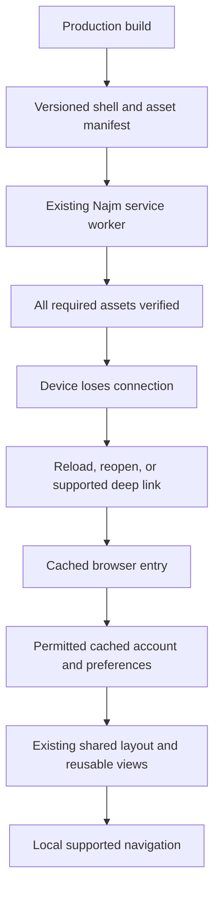
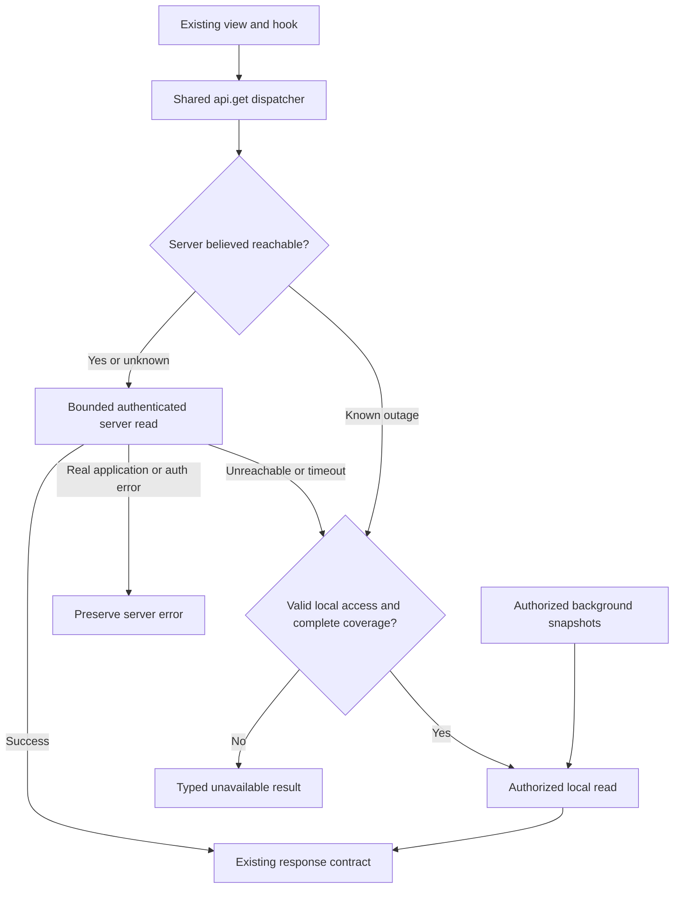

# School offline plan: cached application first, transparent reads next

Prepared: 2026-10-23 (Africa/Casablanca)

Status: **PHASES 0 AND 1 COMPLETE AND DEPLOYED TO THE DEMO** (`a8eed9e`, 2026-10-24; migration 0077 applied by the deploy). Chromium, Firefox and WebKit pass private reads, production renewal events, the edit/access lifecycle and the already-open Next Students transition on real connection failure. An installation turns offline use off with `SCHOOL_OFFLINE=off` (section 10.4). Phases 2 to 4 are deferred; physical Android/iOS checks remain before customer installations; deadline fallback stays disabled. All feature files are unchanged. The endpoint ledger, shared adapters and rollout instructions are in [Phase 1 Students reads](docs/tests/offline-students.md). See [verification and remaining gates](docs/tests/offline-read.md) for dated evidence and local setup.

| Area | Current implementation | Remaining boundary |
| --- | --- | --- |
| Preparation | Silent restored-session preparation, server-issued eight-hour grant, replica access-row CAS and cached-account display adapter | Existing-school ordered migration/deployment and broader role acceptance |
| Public shell | Independent provider, shared sidebar/branding/styles/assets, fixed document CSP, restored selected year and the bounded real Students views | Broader route/role coverage and target-device acceptance |
| Navigation | Real online Students row callback reaches an unvisited offline detail through Next's native failed-RSC document fallback in all three engines; Back/Forward/reload pass | Slow/stalled network behavior and broader feature transitions require separate acceptance |
| Updates | Explicit consent or natural activation after clients close; conservative open-editor protection; legacy-worker migration passes in Chromium, Firefox and WebKit; branded page for unlisted documents; three failed downloads per version per day | Shared authoritative form-dirty integration and recovery acceptance |
| Reads | Phase 1 Students/shared exact projections, immutable bounded snapshots and shared GET dispatcher | Broader modules, devices and release acceptance; deadlines remain disabled |

Phases 0 and 1 are committed and run on the demo. Each customer installation is a separate promotion with its own evidence (section 10.4).

This is the implementation handoff for the owner's current request. The first deliverable is an application that opens, refreshes, and navigates without Wi-Fi. The next deliverable supplies downloaded data through the existing service API contracts. Offline changes are a later deliverable.

This document supersedes the execution order and initial scope in [the earlier offline synchronization proposal](docs/design/OFFLINE-FIRST-SYNC-PLAN.md). That document remains historical design reference, especially for future reconciliation, financial commands, and attachment handling. Its proposed package paths and package-development phases must not be followed without checking the current published APIs described here. Neither document is evidence that School works offline today.

## 1. Decisions from the owner

1. Offline support is for **every user role**, subject to existing permissions and ownership, not only teachers.
2. Prepare for Wi-Fi interruptions of about an hour or several hours.
3. **Cache the executable application first.** Local records are useless if refresh or reopening only displays the existing full-page offline message.
4. Start with **reads**. Keep the storage and transport foundation suitable for later offline changes.
5. Keep the existing design, screens, forms, tables, and module-facing service contracts.
6. Prefer a **local API adapter behind the shared API service**. A component should continue calling its existing hook, which continues calling its existing API function.
7. Preserve existing client feature modules and existing server business modules wherever their contracts permit it. Do not begin by migrating every feature hook to a new database API.
8. Do not add a project-wide button-disabling pass. Offline read work does not introduce a new offline save success state or a hidden mutation queue.
9. Keep this root plan as the implementation handoff. Phase 0 implementation and review corrections are authorized; package publication, production data changes and deployment remain separate work with separate evidence.
10. Start preparation automatically when an online visit resolves a valid authenticated session, including an existing session on `/home` or another dashboard URL. A new visit to `/login`, logout or manual setup is not required.
11. **Preparation is silent.** Do not show preparing/cached/ready banners, toasts, badges or an "Available offline" notice, including after reload. Users continue working while preparation and refresh run in the background. Keep readiness internal for access checks and automated verification. Explain unavailable data only when it affects the screen or action the user is using; background preparation failures must not produce unsolicited notices. Existing update consent that protects unsaved work remains separate.

## 2. Product milestones and completion boundaries

| Milestone | What users can do | What the evidence must establish |
| --- | --- | --- |
| Phase 0: application available offline | After preparation online, open/reopen the app, refresh, follow supported routes, and use the cached layout | Production service worker, complete assets, offline entry, account presentation and navigation work without the Next server |
| Phase 1: one transparent read flow | Read a downloaded list and its details through existing API functions | Local adapter preserves the endpoint contract and feature module files; account/year boundaries hold |
| Phase 2: all-role read coverage | Browse the supported downloaded data for each user's permitted modules | A route/role coverage ledger proves each claim; summaries and filters remain correct |
| Phase 3: read release readiness | Use offline reads reliably on supported devices, across updates and reconnects | Storage, recovery, authorization, browser, performance and release gates pass |
| Phase 4: later offline writes | Save supported changes locally and reconcile them | Explicit commands, durable outcomes, duplicate prevention and conflict handling pass a separate implementation/acceptance slice |

Phase 0 is not complete when a tab merely remains visible after disconnecting. It must survive a reload and a fresh launch. Phase 0 also does not establish offline school-data availability. Do not advance to school-data caching implementation until its startup/navigation gate passes.

Initial operating assumption: a valid authenticated online session and complete background preparation have happened on the same browser profile/device. An existing session is sufficient; preparation must not depend on a login-form submission or visiting `/login`. First-ever login and data never downloaded require a connection. Cached access duration is eight hours, with an explicit bounded server-issued expiry; implementers must encode the chosen duration rather than accidentally inherit a package's seven-day default. This policy is configurable and must not erase stored work on expiry.

Local testing uses a served production build; development does not register/update the worker. Use `bun run preview:offline` and the [acceptance procedure](docs/tests/offline-read.md#test-manually-at-localhost3102). Preparation has no user-facing indicator: tests inspect the controlling worker's `NAJM_PWA_STATUS` reply, complete cached assets and account metadata before disconnecting. A waiting update is not an active prepared worker. Existing waiting updates require **Update application** after saving/closing editors, or natural activation after all School clients close. Never infer legacy identity from a missing status reply.

## 3. Baseline and current dependencies

The School table below records the pre-Phase-0 design baseline at `c17a0fe`, not the current implementation. Current implementation is summarized above and in the acceptance report. Preserve the existing dirty tree; check Git status and diff ownership before editing or committing. Never stage unrelated work.

### 3.1 School before Phase 0

| File/area | Observed behavior | Design consequence |
| --- | --- | --- |
| `apps/dashboard/src/app/sw.js/route.ts` | Uses `createNajmServiceWorker` with an inline reconnect document; no School application-shell manifest is configured | It currently falls back to an offline message rather than opening School |
| `apps/dashboard/src/app/layout.tsx` | Calls `loadUiSnapshot()` on the server; mounts one `NajmAppProvider`, year selection and `NajmPwaRegistration` | A cold offline entry needs its own permitted local bootstrap and must reuse the provider contract |
| `apps/dashboard/src/app/(dashboard)/layout.tsx` | Calls `requireSession()` and reads active-year setup from the server | Saving JavaScript chunks alone cannot execute this layout offline |
| `apps/dashboard/src/shared/DashboardShell/index.tsx` | Uses Next navigation, auth/permissions, expiry redirect and Next-specific sidebar links | Navigation and cached-account presentation require a proved shared integration |
| `apps/dashboard/src/app/(dashboard)/students/page.tsx` | Client wrapper around `StudentsTable` | A neutral route can reuse the view directly |
| `apps/dashboard/src/app/(dashboard)/students/[id]/page.tsx` | Uses Next `useParams()` then passes `studentId` to `StudentProfile` | Offline routing can pass the route parameter directly to the reusable view |
| `apps/dashboard/src/services/http.ts` | Central `api.get/post/put/patch/delete`; GET currently refreshes a token before calling `auth.api.get` | Intercept eligible local reads before online refresh; preserve method and response contracts |
| `apps/dashboard/src/lib/requestHeaders.ts` | Captures language and scoped headers synchronously at request start | Local dispatch must capture these before its first `await`, too |
| `features/AcademicYears/hooks/useYearScopedQuery.ts` | Existing query keys bind account/year; `staleTime: 0`; reads wait for year selection | Preserve key semantics; offline queries must execute and selection must resolve locally |
| `features/AcademicYears/components/AcademicYearSelectionOwner.tsx` | Follows live auth state and clears query data on account change | Distinguish a temporarily disconnected account from actual logout; retain account isolation |
| `services/fileApi.ts` | Uses direct fetch for served files | Not every request passes through `api.get`; attachments need an explicit integration |
| `features/Grades/store/gradeDraftStore.ts` | Tab-local `sessionStorage` drafts | Preserve these existing drafts during shell/update work; this is not durable offline synchronization |
| `apps/dashboard/scripts/next-build.mjs` | Runs the installed Next build with `--webpack` and a controlled output directory | Integrate shell generation with the actual build; do not assume a Turbopack production pipeline |
| Installed Next | `16.3.6` | Read its bundled guides before coding; do not substitute current web docs for the installed contract |

### 3.2 Package capabilities and pins

School currently pins the versions in the second column. Phase 1 adopted the published `najm-database@2.3.3` and matching `fast-idb@0.3.1`; the Desktop reference versions match. Registry availability alone is not proof of integration or browser acceptance; current evidence is recorded separately.

| Package | Current School pin | Available reference/release | Relevant capability |
| --- | --- | --- | --- |
| `najm-database` | `2.3.3` | `2.3.3` | `./sync/contracts`, `./sync/client`, `./sync/server`, `./sync/pg` |
| `fast-idb` | `0.3.1` | `0.3.1` | `./db`; required exact optional peer for the database browser entry |
| `najm-next` | `0.14.0` (unlisted-page fallback and install budget adopted) | `0.14.0` | PWA navigation fallback/staged updates; client provider UI runtime; query configuration |
| `najm-kit` | `3.7.0` (adopted in Phase 0) | `3.7.0` | Provider UI runtime usable outside a Next router |
| `najm-auth` | `6.9.0` | `6.9.0` | `./client/offline`, including `automatic-read` enrollment |

Use these **actual** database imports, not older proposed paths:

- Browser storage: `najm-database/sync/client`.
- Portable types and record validation: `najm-database/sync/contracts`.
- Server operation outcomes, primarily for future writes: `najm-database/sync/server`.
- PostgreSQL schema/transaction utilities: `najm-database/sync/pg`.

`openSyncReplica()` supplies scoped local records, staged snapshots, subscriptions and future outbox primitives. `beginSnapshot`, `stageSnapshotPage` and `activateSnapshot` support complete downloads. `read` and `applyChanges` support local reads and committed changes. `synchronizeReplica()` is a foreground **outbox sender**, not a downloader, read scheduler, HTTP server or automatic School synchronization service.

The package describes its sync APIs as experimental. School owns authenticated endpoints, projection allowlists, download scheduling, permissions, route mappings and browser integration. It does not acquire offline support merely by installing the package.

`najm-auth/client/offline` supplies cached-access policy checks, not a fabricated online session or a complete React account adapter. Automatic read enrollment requires `read:offline` and each permitted `read:<resource>` capability. School's permission/grant catalogs need integration; no existing School offline grant was found in the inspected sources.

### 3.3 Repository rules

- Read `AGENTS.md`, `apps/dashboard/AGENTS.md`, the Najm skill, and relevant installed Next guides before implementation.
- Local Najm and fast-idb sources are read-only references from this workspace. Consume published versions through exact pins and matching overrides; no links, copied package source or local tarballs.
- Phase 0 uses an explicitly temporary localStorage **display-only preparation record**, not an authorization store. Phase 1 adopted `najm-database@2.3.3` and `fast-idb@0.3.1`, initialized the replica access row, and connected Najm's compare-and-swap access helper with `maxOfflineDurationMs: 8 * 60 * 60 * 1000` explicitly. Permitted UI metadata migrates only after a fresh online server grant and successful atomic access-row commit, then the temporary preparation record is removed. The browser-issued expiry never becomes server authorization, and the cached session remains null. Accounts outside the Students slice retain display-only preparation, without private records.
- Preserve one UI provider, one query client, one auth definition and one selected-year owner per mounted application. No parallel preference or entity-state store.
- Preserve the one-line `next.config.ts` export. If a real Next configuration divergence becomes necessary, use the documented `defineNajmNextConfig` boundary and explain it; do not silently add keys.
- Browser code may import School contracts, never School server modules or database drivers.
- The neutral entry is explicitly listed in the workspace browser-boundary policy and also declares `use client`; its transitive browser graph must pass the checker even if that directive is removed accidentally.
- Existing ownership and `@Year()` rules remain authoritative. Read section 0 of the academic-year handoff before backend year integration.

## 4. Architecture

### 4.1 Phase 0: cached executable application



The offline entry is neutral executable code and public defaults. It must not contain an account's server-rendered HTML, tokens, private snapshot or other user's records. Cached access metadata is stored separately and checked before revealing protected context.

### 4.2 Phase 1 onward: transparent reads



The adapter is an in-process local API, not another listening server and not a database connection to PostgreSQL from the browser. During a known outage, a GET resolves locally without a preliminary ping or token refresh. While reachable, preserve server freshness; a bounded request failure can select authorized local coverage. Reachability recovery uses backoff and real API results, not `navigator.onLine` alone. Phase 0 uses `navigator.onLine === false` solely to select a document navigation from an already-open Next page; it is not proof of server reachability. The cached entry independently checks the public health endpoint with a bounded request and offers an explicit return online. Associated Wi-Fi with an unreachable server still needs the programmatic-navigation gate below.

## 5. Preserve feature modules through shared integration

The target is zero edits to existing `apps/dashboard/src/features/**` business components/hooks, existing per-module `services/*Api.ts`, and existing `packages/server/src/modules/<business-module>/**` during the initial transparent read proof.

Shared infrastructure, route composition wrappers, the new offline integration, new server sync module, permissions, schema, tests and package manifests can change. Adding a new server sync module is different from rewriting all existing business modules; report the distinction accurately.

Use a diff-based module-preservation check at each phase. Keep an exception ledger containing path, dependency/contract gap, proposed minimum change, reason a shared solution cannot handle it, and disposition. No exceptions are approved by this document. Identify a necessary exception before implementing it and resolve it against the owner's requirement; do not weaken security or silently drop a module to satisfy a zero-file-change claim.

Known boundaries to prove:

- A view importing `next/navigation`, `next/link`, Next-only image behavior or live auth directly may need a shared adapter. A wrapper can pass route props to reusable views, but cannot magically fix every nested dependency.
- Existing `useAuth()` consumers need a supported way to present an allowed cached account. The offline policy helper alone does not provide that React behavior. Never set an expired JWT to authenticated to make hooks render.
- An existing endpoint may not expose all detail fields or a complete listing. Do not infer missing private details from a broad snapshot.
- Filtering and aggregate semantics vary by endpoint. A generic URL-to-table lookup cannot reproduce all server behavior automatically.

For the neutral build, prefer documented public adapter boundaries. If considering an offline-build adapter for an existing public import surface, enumerate and test that surface explicitly. Do not import private Next router contexts, patch RSC internals, globally monkey-patch `fetch`, or maintain a second copy of feature screens.

Implemented adapter surface: `next/navigation` supplies pathname/search/params, push/replace/back/forward/refresh/prefetch and explicit redirect/not-found behavior; `next/link` maps same-origin links to History navigation with modifier/target/download preservation; `next/image` renders native public images without an optimizer request. These substitutions apply only to the separately bundled neutral entry. Unsupported exports fail the build and require a contract/test before use. The offline-only auth import uses the public client factory with School's auth policy and a null session. It provides hook context, not offline login. The single `NajmAppProvider` per entry rule is documented in `AGENTS.md` and `CLAUDE.md`.

## 6. Phase 0: make School open offline FIRST

### 6.1 Deliverables

- [ ] Record baseline commit/status, exact package pins, installed Next version and available production build instructions.
- [ ] Inventory supported document routes, reusable client views, route parameters, Next imports, auth dependencies and lazy-loaded assets. Include real list and detail navigation.
- [x] Adopt published `najm-next@0.13.0` and `najm-kit@3.7.0`; verify package pins and production compilation.
- [x] Add the neutral entry using School CSS/fonts, `NajmAppProvider`, shared sidebar and public adapters. StudentProfile mounts without feature edits and explicitly unavailable data; complete view/dialog coverage remains open.
- [ ] Supply a single provider with cached public UI preferences/branding defaults and a separately checked cached account presentation. Keep server authentication behavior authoritative online.
- [ ] Resolve the active/selected year for shell presentation from permitted local bootstrap metadata. Do not perform a school-data snapshot download in this phase.
- [x] Use `offline/routes.ts` as the single worker/local document allowlist and the public navigation adapter for supported details.
- [x] Package the JavaScript entry, every emitted stylesheet/asset, School globals, Najm theme styles, flags and both local fonts in an immutable manifest. CSS URL completeness is checked during the build. Dynamic branding and route expansion remain separate coverage gates.
- [x] Configure versioned public fallback, the shared allowlist and staged update policy.
- [ ] Connect PWA update coordination in every controlled window. Respect existing unsaved forms/drafts before activation; reconnect must not forcibly remount or reload them.
- [ ] Confirm manifest `start_url`, home routes, theme image paths, security headers/CSP, dynamic icons and browser startup all resolve correctly offline after preparation.
- [x] Preparation, completion and bounded background retries show no routine status. Worker readiness remains internal; interrupted preparation retains the previous usable build.

Preparation reserves a maximum of three attempts for the same version across open tabs (initial attempt, then 2 s and 5 s). Reconnect may wake a pending delay but cannot reset the budget. Retry that version only after all School clients close and the application is reopened; a different version has its own budget. Verify a missing asset both with HTTP caching and with `no-store`, since failed staged installs can otherwise download every asset again. Keep this School scheduling policy separate from Najm's atomic cache installation.

The budget applies only to School's explicit preparation calls. Every tab connects update consent/build pinning as soon as a worker is active, independently of that budget; offline link handling is also independent. A still-installing worker remains one pending attempt beyond the registration watchdog, cancelled on unmount; only an observed failure starts a retry. The older-worker regression must also exercise browser-started update checks: those can download outside School's scheduler. The [Najm request](docs/design/NAJM-OFFLINE-WORKER-REQUEST.md) requires a worker-side persistent budget before claiming a total mobile-data bound or releasing broadly. School's worker now sets it (`installBudget: { attempts: 3, windowMs: 86_400_000 }`, `najm-next@0.14.0`). Each install reserves an attempt in IndexedDB before downloading, across tabs, app openings and browser checks, so a broken version is downloaded at most three times per day. `test:offline:install` proves this with five browser update checks. Retain the old active worker and its update handling throughout.

### 6.2 Build and navigation decisions

The current protected Next layout is server-dependent. The proposed solution is an independently bootable browser entry using the existing reusable views. Retain normal Next server routing online. Do not indiscriminately cache authenticated HTML or RSC responses.

The implemented shell mounts exactly one `NajmAppProvider` with School i18n, form/table defaults, one QueryClient, public `uiRuntime`, and a **null online session**. Pure no-data proof queries execute with `networkMode: always`, no retry. The neutral entry enables an unavailable-data check **only in shared `api.get`**, before token refresh. Direct file `fetch` calls, auth requests, POST/PUT/PATCH/DELETE and multipart requests are not gated by it; some explicitly include cookies. This is not a global network blocker or authorization boundary. Existing StudentProfile shared-GET queries return an honest unavailable error rather than waiting indefinitely. Before adding other views or permitting private reads, test every direct transport path and its server authorization; a null React session alone does not establish that requests cannot authenticate. Do not hydrate cached identity as authenticated. A real permitted offline-account bridge and transactional grant remain a required pre-private-data gate.

The public navigation adapter memoizes search parameters by the search string and supplies a stable router object. A query change produces new parameters; unrelated renders and path-only navigation preserve the unchanged parameters and router. The browser harness checks these identities.

The shell preference callbacks write School's existing language/theme/time-zone cookies as well as the temporary display snapshot. Reconnection therefore preserves the authoritative cookie-first preference order. No second global preference store is introduced.

The shell draws the online sidebar: `createNavigationItems` supplies its groups, feature icons and current-language labels, limited to the routes prepared online with the real permission checks. The display record stores only those routes and the role that selects the family layout. The school's sidebar logos are API-served branding images, which the worker never caches, so a signed-in online visit stores the two sidebar logo slots in School's own `school-offline-branding` cache. The shell reads them as `blob:` URLs before mounting its provider, and shows the app name when none is stored. Najm's shell caches and cleanup are untouched.

The build spike must choose and record the exact bundling integration compatible with the installed Next version, current webpack build, Tailwind/global CSS, package client directives, assets and CSP. A proposed `build-offline.mjs` may use Bun's build API or an established bundler, but its executable command and output manifest must be proved, not assumed. Keep its generated files inside the dashboard output/public artifact boundary and include them in the deployed image.

Order the shell generation before the Next route build if the worker route imports its generated manifest. Resolve this dependency explicitly. Include the complete build identity in both worker and shell configuration. A new build must not reuse immutable URLs with different bytes.

The production build bakes the shell version into both the online bundle and `/sw.js`, and the worker reads that version's `manifest-<version>.json`, never whichever shell was generated last. `next start` serves only the public files present when it started, so a later shell build (a test run or another build) must not change a running server's precache to files it answers with 404. `manifest.json` names the latest shell for unbuilt runs (development, fixtures) and tooling.

An already-open Next document must also cross into supported offline navigation. A service worker document fallback alone does not catch every Next client/RSC transition. Prove this transition separately from cold startup. Keep navigation local in the neutral entry across reconnects until an intentional, safe transition/update.

The navigation fallback deadline is 10 seconds, matching the package default. This is an initial configurable policy, not a measured normal-page SLA: record the slowest normal first-response distribution before release and increase the deadline if needed. Timeout can select the shell while the server is online. The shell makes a separate bounded health check and offers an explicit online document retry; it never automatically loops reloads or claims Wi-Fi is disconnected. The slow-online fixture must delay headers beyond this deadline without terminating the server request early.

Every online and shell window participates in update coordination. A waiting update needs explicit activation or natural activation after old clients close; slow/unresponsive workers are never classified as legacy from a timeout. No forced reload occurs. Consent protects persisted drafts, active mutations and native input/change edits. Until a public shared form-dirty registry is available, visible business forms/dialogs conservatively block activation until closed; native login fields remain protected by edit tracking. Unknown inline edits remain protected until reset/unmount. A successful save cannot be inferred from a submit event. A future authoritative dirty/commit bridge belongs in shared Najm controls, not separate implementations in every feature.

Retain all builds pinned by live tabs plus two unused generations. Cleanup must preserve suspended tabs, installation staging and the active build, and never delete IndexedDB. Web Lock lifecycle and browser evidence live in the acceptance report. Phase 1's retained shell permits registered online reads only after a fresh server protocol/schema/access handshake. Unregistered shared `api.get` calls remain unavailable there, including after reconnect; this does not globally block other transports.

Data-dependent routes in this phase may show a clear in-app data-unavailable state from a shared route boundary. That boundary can defer mounting a view whose data prerequisites are not implemented, while keeping the actual route, parameter handling and shared navigation usable. This proves shell navigation, not the data-dependent view's complete behavior. Separately exercise representative existing view/provider dependencies in the isolated proof so a generic placeholder shell cannot conceal an incompatible Next/auth dependency. Do not fake school records or counts, show a successful setup form because a server read failed, or leave an infinite spinner. Synthetic data, if needed for a test fixture, belongs only in the isolated harness and is not proof of production data availability.

### 6.3 Authorization and cache boundary

Use the existing offline-access helper and same account identity to gate protected cached presentation. Any bootstrap endpoint must validate online authentication and emit only the allowed display identity, capabilities, scope and expiry; no refresh credential is persisted in the shell or its manifest. A bootstrap permission/catalog integration is allowed in this phase because startup requires it; school-record downloads are not. Use a transactional metadata adapter compatible with the later replica's access row, or document and test an explicit metadata migration; avoid two independently writable cached-account stores.

The actual shared auth presentation bridge is a phase-0 feasibility gate. If published Najm APIs cannot support it without pretending to have a live session, document the missing shared contract and implement it in its owning repository when that work is authorized. Do not work around it in feature modules or access tokens.

The generated public shell carries a fixed CSP before its executable script: self-only scripts/connections, no objects/base URL, explicitly permitted local styles/images/fonts. Test it from the cached response, not only online headers. Frame restrictions require response headers if introduced; a CSP meta tag cannot enforce them.

Limit application-shell fallback to explicit School document paths. The public allowlist also includes `/reports`, `/aging`, `/settings`, `/preferences`, `/transport`, `/drivers`, `/visit-requests` and `/attendance/teachers`; a path outside the cached account's permitted navigation shows the shell's localized "not available offline" state, never private data. **Every other same-origin document navigation** needs the branded public reconnect fallback, including `/`, `/welcome`, `/public-page`, `/academic-year-migration`, sign-in and recovery pages. This requires a published Najm capability; see the [Najm handoff](docs/design/NAJM-OFFLINE-WORKER-REQUEST.md). **Deployment is blocked until every document outside the shell allowlist has that fallback on a real connection failure.** Preserve real HTTP/auth responses and exclude API, RSC, downloads, assets, worker scripts and external origins. Prove both named examples and an arbitrary unlisted document against the candidate worker. Navigation preload remains a shared-package investigation.

 Auth/recovery routes, API paths, downloads and external origins retain their normal behavior. A real 401/403 response is not a network outage and must not be replaced with an apparently authorized cached page. Keep the current push behavior and worker ownership.

### 6.4 Exit gate

Run against a served **production build**, after one complete online preparation:

- [ ] With a valid existing session but no offline preparation, open `/home` and a supported deep link directly. Preparation completes automatically without visiting `/login`, blocking normal use or displaying preparation/status notices. Inspect internal readiness before disconnecting; verify offline reload/reopen afterward.
- [ ] Turn off network access; hard-refresh a supported dashboard URL.
- [ ] A slow but online server selects the shell at the configured deadline, the shell detects reachability and offers an intentional return online.
- [ ] A transient refresh failure preserves preparation; explicit logout clears it and account switch replaces it without exposing another account's context.
- [ ] Mount the actual StudentProfile inside the shell with its real auth/query hooks, show data unavailable, and exercise its router Back control without requesting school records.
- [ ] Close and reopen the app/browser tab while still disconnected.
- [ ] Record target Android/iOS installed-PWA checks in the release gate. They do not block an isolated Phase 1 development proof once its browser startup and private-access prerequisites pass.
- [ ] Open a supported deep link and a supported route never visited online but included in the downloaded asset manifest.
- [ ] Navigate list to detail, back/forward, and between supported views; include transition from an already-open online Next document.
- [ ] No browser error document, generic full-page reconnect fallback, missing JS/CSS/font, infinite auth redirect or server-dependent navigation failure.
- [ ] Logout/account switching locks cached account presentation; first-time offline visitors are not treated as signed in.
- [ ] Interrupted download, cache eviction and a missing asset do not report readiness.
- [ ] Deployment blocker: every named dashboard fallback path shows its in-app offline state, and every other document (including public, migration, auth and arbitrary unlisted paths) shows the branded fallback after real connection failure, in French, Arabic and English stacked and led by the language the app last displayed (`najm-next@0.15.1`). School's worker sets `navigationFallback.otherDocuments: 'offlineDocument'` (`najm-next@0.14.0`), and `test:offline:browser` passes it in three engines. The real Next production server passes it too (`test:offline:registration`). Still to do: confirm it in the deployed image.
- [ ] Update with a second tab and an existing draft preserves the draft and avoids mixed-build assets.

Record blockers and module exceptions. **Phase 1 development requires the supported-slice production-browser startup/navigation gate and private-access prerequisites.** Physical-device durability, all-role coverage and deployment proof remain release gates. Name the supported subset; do not label Phase 0 or release acceptance complete while those gates are open.

## 7. Phase 1: shared local API and one complete read proof

### 7.1 Scope

Use Students list and student detail as the first integration proof for accounts already authorized to read them. This is a bounded technical proof, not a teacher-only product decision. Use a restricted account and a second academic year in the isolation tests. Parent/student-specific profile routes are covered with their own actual permissions during expansion.

The first detail proof covers the student identity, sidebar and Overview read projection, including the linked-parent and enrollment/class/section dependencies actually requested there. Audit eager alert/profile queries before claiming this bounded coverage. Attendance, Grades, Fees, Transport and Alerts panels are not part of the first read slice; return explicit unavailable results for uncovered requests. Finance must not enter through an incidental Fees-tab dependency. Record the panel/endpoint ledger before implementation.

Keep existing `StudentsTable`, `StudentProfile`, `useStudents`, `studentApi.ts` and the server Students module unchanged if their contracts allow it. The shell route registry can import reusable views directly instead of importing their Next page wrappers.

### 7.2 Local data ownership

- Open the existing package replica through `najm-database/sync/client`, with one installation/account identity and separately downloaded year/shared scopes.
- Use immutable account, installation epoch, authorization generation, scope and schema version metadata. Keep a stable installation identity in the local access contract; do not derive it from mutable school names or invent a different ID on each boot. Persist server-side device registration only if the read-grant issuance/revocation policy requires it. Future write-device management is not automatically part of this read slice.
- Use the replica's metadata/access row for the auth helper's transactional compare-and-swap adapter. Policy checks must include scope, permission, expiry and account; opening a database is not authorization.
- Persist records and coverage in IndexedDB. React Query holds disposable rendered query results; Zustand is not a second authoritative entity database.
- Keep shared catalogs and year-scoped data explicit. A query for year A must never read year B while a download or year switch is in flight.
- Request persistent browser storage where supported and handle quota, denial and site-data eviction. Report availability based on actual contents, not a remembered readiness boolean.

### 7.3 The local API contract

Change shared `api.get` to capture the request context first and delegate registered reads to a local dispatcher. Existing per-module API functions continue calling it.

Each route registration must define:

| Field | Requirement |
| --- | --- |
| Identity | Method, normalized path and supported path parameters |
| Parameters | Validated query keys, defaults, date/search/sort/pagination behavior |
| Scope | Installation/account, selected year or explicit shared/cross-year rule |
| Authorization | Resource capability and source ownership constraints |
| Dependencies | Required local records, detail projections and shared references |
| Coverage | Exact downloaded request or complete dataset needed to answer it |
| Response | Existing nested response envelope, null/empty conventions and error behavior |
| Freshness | Download timestamp, refresh trigger and invalidation dependencies |

Preserve `services/http.ts` wrapping and each `*Api.ts` return shape exactly. For example, `getStudentsApi()` already unwraps `res.data`; an additional or missing `data` level will break unchanged hooks.

Preserve language-sensitive payloads by storing language in the projection identity or using language-independent records with equivalent formatting. Canonicalize parameters without collapsing semantically different filters. For dated rosters, include the requested date and placement semantics; do not answer them with today's roster.

Dispatch order:

1. Capture method, normalized URL/query, language, account and academic year synchronously before the first asynchronous operation.
2. While the server is reachable or its state is unknown, start the existing authenticated server read. Each registered route must define a cache-display deadline from measured successful response distributions (including representative devices, slow links and normal large queries): record sample conditions, p95/p99, chosen margin and deadline in its route ledger. Do not invent a global timeout or enable timeout fallback before measuring that route. Preserve current refetch-on-mount/focus behavior so another user's changes remain visible online.
3. **Deadline fallback defaults off, including the initial Phase 1 proof.** A route may enable it only after measurement and the late-response bridge below pass. Then the deadline may display valid cached coverage while the **same server request continues**; do not abort/cancel it or mark the connection offline. Its late answer reaches the existing query owner through the explicit route-to-query bindings below; `api.get` never guesses its calling query. An eventual 401/403 immediately locks the affected private reads and removes that fallback; preserve other HTTP error semantics. Only a real connection failure selects known-outage mode and bounded recovery probes. An abort caused by navigation/logout, a timeout, `navigator.onLine`, or a slow health probe is not evidence of a connection failure. Never fall back for 401/403/404, validation errors or arbitrary server exceptions. Any deliberate 502/503/504 fallback needs an explicit endpoint policy and tests; it must not globally mark the server offline.
4. During a known outage, registered reads go directly to their captured local scope without a ping or online token refresh. Enforce account, year, capabilities, grant expiry and complete coverage first.
5. Return the existing response envelope from valid local coverage. Missing coverage returns typed `OFFLINE_DATA_UNAVAILABLE`, never `[]`, zero totals or a fabricated 404. Freshness/coverage remain internal; no routine preparation/status UI.
6. On successful recovery, restore server reads, revalidate offline access and schedule replacement snapshots. Deduplicate recovery work across concurrent requests.

Successful online responses may refresh an exact registered query projection only with its captured account/year/query/authorization generation. A paginated list does not prove full dataset coverage; detail patches do not prove deletion or aggregate consistency. Do not merge arbitrary successful GETs into a supposedly complete snapshot. Complete generations activate atomically through the download protocol.

Unregistered reads stay on the existing transport path and are listed as unsupported offline. Do not intercept writes, auth endpoints, AI requests or arbitrary external URLs. Do not change every `fetch()` globally.

#### Late-response bridge decision (required before enabling deadlines)

Use **committed exact projections plus explicit query bindings**, owned by the central route registry and a single runtime under the existing QueryClient. Do not infer the calling hook from `api.get`, add a QueryClient, or rely on broad invalidation to somehow display a late value. Normal online reads remain server-first; this bridge applies only to a request that already returned an interim local result.

1. Each deadline-enabled registration supplies `queryBindings(context, params)` returning the exact existing query keys and a typed projection from the API envelope to each query's stored value. For the first Students proof, the current keys are `['students', accountId, 'academicYear', year]` and the same key plus `studentId`; `getStudentsApi`/`getStudentByIdApi` return the HTTP wrapper's `.data` (the server body). Bind only those proven shapes. Dated lists, other profile panels and unscoped keys remain deadline-disabled until separately mapped and account-safe.
2. Capture canonical request identity, account, year, language, authorization generation, scope revision/mutation epoch and a monotonically increasing request sequence. On a late success, validate the envelope and atomically commit only that exact projection, with compare-and-swap against the captured identity/epochs/latest request sequence. Do not activate a full dataset or advance unrelated coverage. After commit, publish an internal projection-committed event containing identity and revision, never a global "refetch everything" event.
3. The one runtime subscribes to those events and the existing QueryCache. For each registered matching query that already exists, wait until its current fetch finishes before applying the replacement, so the original promise returning cached data cannot overwrite it. Recheck account/year/language/access generation, mutation epoch, latest request sequence, projection revision and exact query binding immediately before `queryClient.setQueryData`. Discard superseded events or queries removed by logout/account change. Use the binding's projector, preserving the hook's existing nested response shape; do not create queries for absent consumers. No second server request or special cache replay is required to display this committed late answer.
4. A newer read or mutation wins over an older event. Coalesce queued events to the newest eligible revision and dispose the subscription on runtime teardown. Separate tabs may receive a revision notification and reread the committed exact projection only after their own access/context checks. Revocation/late 401/403 must lock through the shared access owner and remove affected query results/coverage immediately, including queued events. Other late HTTP errors retain the endpoint's reviewed error behavior; a deadline cannot hide a terminal refusal behind stale data.
5. Before opting in even one route, prove with the real QueryClient and unchanged Students hooks: interim cached render followed by a changed late server render; completion before/after the original query settles; multiple observers; exact envelope parity; no refetch loop; newer reads/mutations; language/year/account switch and logout; late 401/403/404 and terminal server errors. If a binding or error path cannot satisfy those tests, keep that route's `deadlineFallback: false` and await the server response normally. These contracts are design requirements, not implemented Phase 0 behavior.

### 7.4 Route projections and server reuse

Use centralized School mappings rather than module edits. Prefer reusing existing authorized response projections, especially for aggregates, student profiles and finance. A local lookup can answer a detail from a complete downloaded detail projection; it cannot assume a list row contains the full detail.

For each endpoint choose one of two explicit strategies:

- **Exact response projection:** store the authorized server result for a canonical request. Appropriate for complex calculated summaries and bounded parameter combinations. A new filter/date not downloaded is unavailable until fetched.
- **Complete record projection:** store sufficient authorized records and relationships to answer a documented family of queries. Implement and test a local selector equivalent to the endpoint's filters, sorting, pagination and error semantics.

Both strategies can use `ReplicaRecord` values. Keep route mapping and selectors in the new integration area. Do not reproduce business validation in the browser or recalculate complex financial rules merely to avoid a server projection.

A new server sync module supplies the allowed scope, immutable snapshot manifest and bounded pages. Reuse the authoritative route authorization policy; do not copy every controller's permission rules into a second list. Prefer a shared guarded read-invocation boundary, with a strict allowlist of read operations. Najm MCP demonstrates guard execution, isolated invocation context and School year hooks, but `invokeTool()` produces MCP text/error envelopes rather than the existing HTTP envelope. Prove input validation, HTTP response/error parity, ownership, year isolation and cancellation before using it behind a batch endpoint. Never expose arbitrary controller/tool names or mutations through a read downloader.

**Direct service invocation skips controller guards.** Any consistent projection using services must explicitly reuse the same shared resource policy and request context. Sign-in or a broad sync permission is insufficient. If the required reusable invocation API is missing, add it at the owning Najm package boundary through a published release; do not copy framework internals into School.

Register a sync controller that reaches `@Year()` repositories in `config/yearScope.ts`, once under its tool-group key. Do not redeclare `academicYear` in its own request schemas if the registered transport injects it. Follow the existing `OwnedWhere` rules, with no broad all-record export followed by client-side filtering.

Use a consistent server snapshot generation for dependent data. A transaction/snapshot must use existing request/year/ownership context. If existing methods cannot participate consistently without a module change, record that exception. Do not label several sequential HTTP results a point-in-time snapshot. Financial totals and their supporting rows require a consistent projection before claiming offline parity.

Persist only metadata/tables actually needed for snapshots, installation identity, revisions and access generation. Use the package PostgreSQL schema where appropriate and review additive Drizzle migrations. Do not invent fake revision numbers that reset on every download. Establish how server generations/record revisions remain valid for a future write baseline before freezing contracts.

### 7.5 Complete downloads and refreshes

Use `beginSnapshot` before the request, stage validated pages, and activate only after manifest checks succeed. Respect the current package page limits of 500 records and 1 MiB serialized data. Activation is atomic per scope; preserve the prior complete snapshot until replacement succeeds. Cross-scope dependencies require compatible readiness checks.

Those limits are enforced by the browser package; its generic server operation helpers do not split School downloads. School's snapshot endpoint must enforce both serialized-byte and record limits itself, including a defined refusal for an individual oversized projection.

Start with snapshot refreshes for the small proof. This avoids requiring a transactional change feed on every existing business writer in the read-first milestone. On online app startup with a valid restored or newly established session, obtain or renew the server-issued offline-access grant as needed and schedule missing/stale permitted downloads for the selected year. This lifecycle belongs below the shared auth/query owners, not in the login form. Refresh after reconnect, resume with stale data, selected-year changes, explicit refresh, and successful online mutations affecting the scope. Use bounded concurrency and backoff; do not block the first usable online render on a full school download. Preparation and refresh remain silent; failures retain the previous complete authorized snapshot where usable and retry without background alerts.

Freshness after online edits needs a deliberate shared mechanism. Existing mutations may invalidate queries whose local snapshot is still old. Mark affected coverage stale at successful server mutation, then fetch authoritative reads/refresh the snapshot before serving that old value as current. Track dependencies, such as a student edit affecting parent/class views. Lost mutation responses retain existing error semantics; do not blindly replay them.

Server deletes are reflected when a complete replacement snapshot activates. Permission or ownership changes require a new access generation and refreshed permitted coverage; old data must stop being exposed when revocation becomes known. A disconnected device cannot learn a remote revocation immediately, so bound offline access and revalidate on reconnect. A true 401/403 cannot trigger fallback that silently bypasses the denial.

Future incremental pull is optional after measurement. It requires commit ordering, deletions/tombstones, membership changes and every-writer coverage, including REST, MCP, jobs and imports. `applyChanges()` does not create that server feed automatically.

### 7.6 Access renewal and existing-school rollout

- Obtain an eight-hour server-issued read grant for a valid restored or newly authenticated session. Request fresh server authorization on **every successful `tokenRefresh`**, plus online startup, reconnect and visibility resume; never wait for the final 30 minutes of the old grant. While actively online, a deduplicated 15-minute renewal schedule ensures the gap between authorization checks is at most 15–30 minutes even if token refreshes are less frequent. Deduplicate concurrent triggers and use bounded retries. A timer is advisory because browsers suspend tabs; resume must renew immediately. Each successful authorization sets expiry to the server's authorization time plus eight hours, so the window is eight hours from the last successful grant renewal (normally within 15 minutes of losing Wi-Fi), never eight hours from an arbitrary ordinary API response.
- Token refresh is a trigger, not an offline grant. Persist a renewal only after fresh server authorization and a successful compare-and-swap access-row commit. Capture account/generation before the request; discard late responses after logout/account switch. Failed renewal cannot extend the old expiry. Known refusal/revocation locks private reads; clock rollback remains denied.
- Test a session open beyond eight hours with successful renewal, followed by a Wi-Fi interruption; also disconnect at 14:00 when the previous grant would expire at 15:30 and verify recent online renewal retained roughly eight hours, rather than 90 minutes. Test the maximum renewal interval, permission revocation at the next check, sleeping tabs, failed renewal, expiry, logout and late grants. Failed online authorization must never be described as a fresh eight-hour window.
- Ship additive, idempotent permission migration plus updated fresh-install seed defaults. Add `read:offline` to the explicitly intended existing standard roles without resetting unrelated/custom grants or broadening any resource permission. Do not depend on an unnoticed manual seed command. Custom-role treatment and operator revocation behavior must be explicit.
- Verify effective permissions and enrollment in deployment acceptance. Support diagnostics may inspect internal status/logs; do not introduce an unsolicited notice or a new Preferences screen as part of this correction.

### 7.7 Query/provider integration

Configure the existing query integration centrally through `NajmAppProvider`, using the published query adapter. Do not add a second QueryClient. Set an appropriate read network mode so a query reaches the local dispatcher while disconnected; `offlineFirst` is a candidate for local-or-network reads. Validate its paused-retry and reconnect behavior. Pure local queries can use `always` where needed, but do not apply that change indiscriminately to mutations.

Keep existing account/year query keys. Audit generic and dashboard keys for account isolation; clear the shared cache on real account switch and protect late results from the previous identity. Restore year selection from the same captured cached account context on offline boot. Do not mistake an offline refresh failure for a sign-out.

The phase does not create an outbox for existing POST/PUT/PATCH/DELETE requests, show local edits as server success, or introduce automatic delayed replay. Preserve form input when a save cannot reach the server. No broad button-disable redesign is part of the work.

### 7.8 Exit gate

- [x] Supported-slice cold startup remains passing with the real replica attached (Chromium, Firefox and WebKit). WebKit uses a loopback HTTPS fixture, preserving production Secure cookies/CSP. No physical-device/release completion is claimed.
- [x] List/detail payloads match existing online endpoint shapes and semantics (real fixture HTTP, two years).
- [x] A downloaded detail opens offline even if that detail page was not visited online (Chromium, Firefox and WebKit).
- [x] An already-open online Next Students row action reaches that unvisited offline detail after real server shutdown while `navigator.onLine=true`. The actual `router.push` first fails RSC, then Next's native document fallback reaches the worker. Back/Forward/reload pass in all three engines; no feature edit or private router API is needed.
- [x] Existing Students feature/API/server module files remain unchanged. The owner declined all feature-file exceptions; the bounded view uses documented public adapters/composition.
- [x] Restricted ownership, account switching, two years and late network responses do not leak data (real fixture HTTP/browser and replica race tests).
- [x] Interrupted downloads, injected quota failures and missing coverage retain correct state. Real-device exhaustion/recovery remains a release check.
- [x] Reconnect updates changed/deleted records; an actual Students-form edit survives offline reload without reverting (Chromium/Firefox/WebKit fixture).
- [x] Refresh/reopen offline reads local records without token-refresh blocking or paused-query spinners (Chromium/Firefox/WebKit); server revocation also survives a fresh browser process with the server stopped.
- [ ] If enabling deadline fallback: each route's cache-display deadline has measured response evidence; a slow successful request remains in flight and replaces its interim cached result. Late denials, account/year changes and newer responses cannot expose stale private results. Timeout alone never selects known-outage mode. **No route enables deadline fallback in this initial proof; this is an enablement gate.**
- [x] Successful token refresh and the 15-minute online schedule renew grants through fresh server authorization (actual Chromium/Firefox/WebKit production runtime). Controlled-clock tests with the published access helper cover nine hours online, the 14:00 interruption example, the maximum interval, sleeping-tab resume, failed/late renewals, expiry and known refusal. Real device suspension remains a release check.

## 8. Phase 2: expand reads across all roles and modules

Before adding more feature screens, compare a measured static Next-shell spike with the current independent build. A Next-shell candidate must prove cold reload/reopen, unvisited routes and dynamic details without server/RSC requests; caching chunks alone is insufficient. Do not replace the working architecture based on assumed router compatibility. If retaining the independent build, replace the current single approximately 3.43 MB JavaScript bundle (`splitting: false`) with explicit lazy route imports and immutable shared/route chunks. Merely enabling bundler splitting without lazy boundaries is insufficient. Generate the complete precache manifest from every emitted required chunk, CSS and font; verify atomic interrupted installation, cold deep-link launch, lazy navigation, update/rollback retention and deployed asset availability. Establish compressed-size, preparation-time and peak-storage budgets on representative phones before expanding coverage. This is a Phase-2 entry gate, not a claim that splitting is implemented in Phase 0.

For each module family, add route definitions, projections, coverage tests and any required cached view assets. Do not mark a family complete from one list endpoint. Cover detail pages, filters, counters, related panels and mobile/infinite pagination.

| Family | Required read coverage | Special obligations |
| --- | --- | --- |
| Settings and academic catalogs | Permitted public/admin settings, years, cycles, subjects, classes, sections, fee types | Separate public from admin fields and shared from year-owned data |
| People and profiles | Students, parents, teachers, staff and permitted profile panels | Detail/list parity, relationship privacy, dated enrollment/placement, own-child/own-record restrictions |
| Academics | Attendance, routines, assessments, exams, grades, discipline, behavior rewards | Dated rosters, teacher assignments, selected-year rules and role-specific profile routes |
| Finance | Fees, installments, payments, allocations/credits, expenses, payroll, aging and reports | Consistent server-calculated summaries, exact amounts, display rounding conventions, complete dependencies and explicit cross-year scope |
| Dashboards | School, academic, operations, finance and role-specific dashboards | Preserve endpoint year semantics; distinguish last downloaded values from live counts |
| Transport | Vehicles, drivers, assignments/routes, maintenance and refuels | Route/class ownership and current versus historical assignments |
| Communications and operations | Announcements, alerts, events/calendar, notifications, visit requests and reminders | Download permitted history only; delivery and new live events remain network-dependent |
| User/access administration | Authorized user/role/permission listings | Explicitly allowlisted display data; never credentials, tokens, secrets or recovery artifacts |
| Files and generated reports | Explicitly selected authorized files and supported reports | File availability is independent of record readiness; unsupported generation remains network-required |

Role coverage must include real fixture accounts representing administrator, accounting/finance, teacher, parent, student, and other configured restricted roles. Give each only the offline capability and resource visibility intended for that role. Do not grant broader domain access to make a test pass.

Read-only data tests must not change financial filters, receipt design, attendance behavior or other product rules. In particular, do not carry forward the old proposal's unsolicited Fees default-filter changes.

Exit: the coverage ledger accounts for every existing route/action family as supported offline, deliberately network-required, or outstanding. No broad all-app claim while important permitted routes remain outstanding.

## 9. File and package map

Paths below are proposed unless identified as existing. Create only files needed by the phase; do not scaffold every future-write file during read work.

Since 2026-10-25 the reusable parts live in Najm's `najm-offline` package, configured by School with `namespace: 'school'`, which keeps every storage key, database and lock name. That covers the protocol, client runtime, replica, dispatcher, renewal, worker registration and updates, shell adapters, server grant/snapshot/page protocol, snapshot table, worker route, shell build and browser error audit. School keeps its configuration and screens: `contracts/offline` (routes, written paths, switch), `src/offline/{runtime,access,bootstrap,routes,updates}.ts` (adapters), `OfflineRuntime`, `OfflinePreparation`, `entry.tsx`, `StudentReadView`, `shellNavigation`, the server `offline` module (guards, lookups, projections) and `scripts/build-offline.mjs`. The source map below records where each piece was first written.

Original source map: the Phase 0 registration/readiness/navigation/update modules remain. Phase 1 adds `contracts/offline`, `access.ts`, `replica.ts`, `localApi.ts`, `runtime.ts`, `queryPrivacy.ts`, `OfflineRuntime.tsx`, and the server `offline` module. `cachedAccount.tsx`, `kit.tsx`, `readCoverage.tsx` and `StudentReadView.tsx` are explicit public build/composition adapters; the old unavailable-only `transport.ts` is retired. Both provider contracts and the browser boundary policy include the neutral entry. See the Phase 1 ledger for implemented versus future coverage.

### 9.1 Phase 0 first

| Path | Kind | Purpose |
| --- | --- | --- |
| Root/workspace `package.json`, `bun.lock` | Existing | Exact published shell/provider package adoption |
| `apps/dashboard/src/offline/entry.tsx` | New | Browser-only boot entry reusing School UI |
| `apps/dashboard/src/offline/routes.ts` and `entry.tsx` | Existing Phase 0 | Current allowlist and view composition; introduce a separate view registry only when expansion needs it |
| `apps/dashboard/src/offline/navigation.tsx` | New | Shared offline navigation integration and transition from online navigation |
| `apps/dashboard/src/offline/bootstrap.ts` | New | Versioned permitted account/UI metadata; no school-record replica download |
| `apps/dashboard/src/offline/access.ts` | New | Existing Najm offline-access helper integration; transactional metadata adapter |
| `apps/dashboard/src/offline/OfflineRuntime.tsx` | New | One lifecycle below existing auth/query owners; later reused for reads |
| `apps/dashboard/src/providers/AppProviders.tsx` | Existing | Stable provider runtime, extensions and existing query integration |
| `apps/dashboard/src/shared/DashboardShell/index.tsx` and shared navigation | Existing | Reuse layout with supported local routing/cached-account presentation |
| `apps/dashboard/src/app/sw.js/route.ts` | Existing | Versioned explicit assets, navigation fallback, staged updates; retain push |
| `apps/dashboard/scripts/build-offline.mjs` | New | Production shell build and generated manifest |
| `apps/dashboard/scripts/next-build.mjs` | Existing | Run shell build in the proved order; retain current build/env behavior |
| Generated shell/manifest/assets under dashboard artifact output | Generated | Immutable deployable resources, not manually maintained source |
| `apps/dashboard/src/app/manifest.ts`, root layout, shared page-access wiring | Conditional shared changes | Correct launch URL, registration and boot contract where needed; retain online guards |
| `packages/contracts/src/offline/index.ts`, `packages/contracts/package.json` | New export | Browser-safe bootstrap/read contracts; no server imports |
| New server sync/bootstrap module and permission catalogs | New/shared | Only the bootstrap access integration needed by the shell in this phase |

### 9.2 Phase 1 and expansion

| Path | Kind | Purpose |
| --- | --- | --- |
| Root/workspace `package.json`, `bun.lock` | Existing | Exact `najm-database`/`fast-idb` adoption where consumed |
| `apps/dashboard/src/services/http.ts` | Existing | One interception boundary for registered GETs; preserve online mutation path |
| `apps/dashboard/src/offline/replica.ts` | New | `openSyncReplica` lifecycle and account/year context |
| `apps/dashboard/src/offline/localApi.ts` | New | Local dispatch and exact response/error compatibility |
| `apps/dashboard/src/offline/queryBridge.ts` | New, Phase 1 | Explicit request-to-existing-query bindings and commit-driven late-result application; deadline fallback stays disabled until proven |
| `apps/dashboard/src/offline/routes/*.ts` | New | Route registrations and resource-specific read selectors/projections |
| `apps/dashboard/src/offline/download.ts` | New | Manifest/page validation, atomic activation and refresh coordination |
| `apps/dashboard/src/offline/query.ts` | New | Stable shared query defaults, coverage invalidation and cache notifications |
| Existing shared `lib/requestHeaders.ts` | Conditional | Only changes required to preserve synchronous captured context |
| Existing `features/AcademicYears/components/AcademicYearSelectionOwner.tsx` and year-selection store | Shared integration exception candidate | Offline cached-account/year restoration; record actual paths as shared-boundary changes |
| `packages/server/src/modules/sync/SyncController.ts` | New | Explicitly guarded bootstrap/snapshot endpoints |
| `packages/server/src/modules/sync/SyncDto.ts` | New | Request/response validation and package protocol compatibility |
| `packages/server/src/modules/sync/SyncService.ts` | New | Snapshot orchestration through existing business reads |
| `packages/server/src/modules/sync/SyncRepository.ts` | New | Snapshot/installation metadata persistence and consistent read orchestration |
| `packages/server/src/modules/sync/SyncGuards.ts`, `SyncSchema.ts`, `index.ts` | New | Permissions, package schema composition and module export |
| `packages/server/src/modules/sync/projections/*.ts` | New | Central explicit mappings to existing permitted business reads |
| Existing `modules/index.ts`, `config/yearScope.ts`, database schema index | Existing | Register the new module and correct repository context |
| `packages/server/src/database/migrations/` | Additive generated changes | Only reviewed metadata/schema required by the implemented slice |
| Seed `admin/data/permissions.json`, `rolePermissions.json` and scoped seed helper if needed | Existing/new shared | Add offline-read capability without resetting roles or replacing custom grants |
| `packages/contracts/src/locales/{ar,en,fr,es}.json` | Existing | Contextual unavailable-data and necessary update-action messages; no routine preparation/readiness notices |
| `apps/dashboard/tests/offline/`, `packages/server/tests/sync/` | New | Contract, isolation, download and transport tests |
| `docs/tests/offline-read.md`, `docs/evidence/offline/` | New during implementation | Route/role coverage and evidence ledger |

The first read slice should not require edits to existing per-module `*Api.ts`, feature hooks, tables/forms, or server business logic. Shared year/auth integration paths physically inside a feature directory must be named honestly in the diff; do not claim literally zero feature-directory changes if those files change.

## 10. Phase 3: recovery, verification and read-release readiness

### 10.1 Required scenario matrix

| ID | Scenario | Expected evidence |
| --- | --- | --- |
| S01 | Offline hard reload after completed preparation | Cached entry opens, assets resolve, no full-page reconnect fallback |
| S02 | Close/reopen and installed-PWA launch | Correct permitted cached account/layout restored |
| S03 | Unvisited but packaged route and detail deep link | Local route/navigation works without RSC/server dependency |
| S04 | Online document loses network during navigation | Supported transition reaches cached UI without a stuck Next request |
| S05 | Partial shell preparation or asset eviction | Readiness false; prior complete build retained where available |
| S06 | Two tabs, unsaved grade/form input and new worker | Activation respects active work; no forced reload or mixed assets |
| S07 | Real 401/403/404 versus unreachable server | Permission/not-found responses are not disguised as an outage |
| S08 | Existing authenticated session, no offline cache, direct dashboard launch | Silent automatic preparation without `/login`; internal readiness verified before successful offline reload/reopen |
| R00 | Existing authenticated session, no local records, direct dashboard launch | Server-authorized selected-year download completes silently while online work continues; permitted list/detail reads work after disconnect |
| R01 | Registered list/detail online versus local | Exact shapes, counts, values, ordering, null and errors match |
| R02 | Search/date/filter/sort/page combinations | Only supported equivalent results returned; incomplete coverage explicit |
| R03 | Partial data download then crash/reopen | Old complete scope survives; incomplete generation never activated |
| R04 | Account A to B, logout and late A response | No A records/query results displayed for B; local policy locked correctly |
| R05 | Year A to B during a download/read | Response stays bound to its captured year; no relabeling |
| R06 | Parent/student/teacher/finance restrictions | Same ownership and domain permissions as corresponding online routes |
| R07 | Membership/permission changes while disconnected | Bounded cached access; known revocation locks stale coverage on reconnect |
| R08 | Successful online update/delete while replica exists | Local reads refresh without reverting to stale data |
| R09 | Local coverage missing and no connection | Typed unavailable state; no fabricated empty list or zero balance |
| R10 | Slow/flapping network, DNS failure, captive portal | Bounded retries and honest reachability; no ping before every local GET |
| R11 | Quota denial/eviction, blocked DB upgrade, multiple tabs | Recoverable state and correct coverage; no automatic destructive reset |
| R12 | Long-running online session, grant renewal, expiry, clock rollback and dataset epoch change | Server-authorized renewal survives a later outage; failed/late renewal cannot extend or cross account access |
| R13 | Arabic/RTL, French/English/Spanish and school time zone | Same layout/formatting and correct dated query semantics |
| R14 | Direct file request and unavailable attachment | Attachment coverage handled separately and honestly |
| R15 | Existing save attempted while offline | No new false server-success message or hidden read-phase replay queue |
| R16 | Account/year data behind local selectors and summaries | Complete dependency sets and consistent server projections |

Use fixture-backed production-mode browser acceptance in Chromium, Firefox and WebKit, and real target Android/iOS installed-PWA checks where those devices are supported. Engine emulation alone does not prove physical device lifecycle or storage durability. Record unsupported platforms explicitly.

### 10.2 Verification commands

Run smallest relevant checks first, using Bun and actual root scripts. Documentation-only preparation does not require an application build.

Existing relevant commands:

```text
bun run test:boundaries
bun run test:config
bun run test:academic-years
bun run test:ownership
bun run test:security
bun run lint
bun run typecheck
bun run i18n:check
bun run build
bun run db:check
```

Existing scripts now include `bun run test:offline` and `bun run test:offline:browser`; the latter builds the shell and runs the served-worker browser harness. Run full `bun run test` at the read-release gate. Run real PostgreSQL/transport checks against a clearly identified disposable fixture, with no production reset or demo seeding in the real school database.

For package upgrades, verify registry/tarball exports and peer requirements, exact root/workspace pins and matching overrides. Do not infer published behavior from newer local source. Package source tests, installed-consumer checks, browser proof and deployment proof are separate evidence boundaries.

### 10.3 Performance and storage acceptance

In **Phase 1**, before choosing local-GET selectors, measure on representative low-memory phones and school/year sizes. Record compressed assets, preparation duration, local latency, peak replacement storage and memory. The current `replica.read()` loads **all records across all scopes**, the outbox and mappings, then filters in memory. Do not call it independently for every row or GET without measuring that cost. Use commit-driven memoized scope views or a reviewed package indexed-read improvement when needed; avoid a second writable entity store. Phase 3 repeats release-scale acceptance rather than postponing discovery of this cost.

Keep initial UI interactive during preparation. Bound page size/concurrency, pause optional work when necessary, and prioritize the selected year's permitted scope. Full snapshot refreshes are acceptable for the initial proof; if scale requires deltas, implement their full every-writer/authorization contract rather than hiding stale data behind long freshness windows.

### 10.4 Rollout and rollback

- Introduce separate app-owned shell/read capabilities, with per-route readiness and a controlled pilot cohort. Implemented so far: one per-installation switch, `SCHOOL_OFFLINE=off`, which refuses grants and downloads and serves a worker without the shell that takes over on the next online visit, keeping downloaded data locked. Runbook and rehearsal (`test:offline:switch`): [Phase 1 Students reads](docs/tests/offline-students.md#off-switch-and-recovery).
- For each release, record exact package versions, commit, migrations, artifact/build identity and route coverage.
- Keep worker update activation staged. A rollback build must preserve the old shell assets needed by open clients and must not delete IndexedDB data automatically.
- Emergency recovery runbook: publish a known-good compatible `/sw.js` and retained assets at the same scope; bring the device online, save/export pending work, close all School tabs and installed windows, then reopen to allow browser update/natural activation. Verify the active worker/build through its protocol. A broken UI must not make recovery depend solely on its Update button. If that fails, use an explicitly reviewed support procedure that unregisters only the affected worker after preserving work, without clearing cookies/localStorage/IndexedDB. Test the broken-worker scenario before production; no forced activation or destructive site reset is authorized by this plan.
- Disabling reads should return connected traffic to the existing server path. Do not ship a worker that strands already-prepared offline devices or erases their data as cleanup.
- Database migrations are additive where possible. Roll back application capability separately from deleting schema; preserve snapshots/access metadata needed for recovery.
- A destructive remove-device/reset operation is explicit and scoped. When offline writes are added, pending work must remain recoverable before any deletion.
- Commit/push, CI/image publication, database migration, demo/pilot deployment and customer promotion each need their own actual status/evidence. A successful build is not deployment or offline acceptance.

## 11. Phase 4: later offline changes, using this foundation

This is the future milestone, not part of read-only implementation. The package replica already reserves outbox and operation primitives, so keep schema and identifiers compatible while leaving mutation routing on its existing server path during reads.

Before enabling the first offline command:

1. Define explicit versioned School domain commands, required permissions, expected record revisions, immutable operation IDs/hashes and dependency references.
2. Route a supported action through one authoritative command path online and offline. Do not build a generic retry queue of arbitrary failed HTTP requests or parallel writers that diverge.
3. Persist pending intent atomically, preserve it across restart, and show local pending versus server-confirmed outcomes. This changes save semantics and needs its own UI acceptance, even if forms retain their design.
4. Expose guarded push/status endpoints using `najm-database/sync/server` and durable PostgreSQL outcomes. Recheck live permissions and domain rules inside the transaction.
5. Resolve uncertain outcomes by original operation identity before resending; a lost response must not create a new operation/payment.
6. Add transactionally ordered changes from every writer before relying on delta reconciliation. Preserve deletes, membership changes, cross-year moves and dependent projections.
7. Define conflict/rejection handling that retains the user's work. Do not silently overwrite another user's changes or automatically merge fields without a reviewed rule.
8. Introduce offline-write enrollment and capabilities explicitly; read-only automatic enrollment must not accidentally authorize commands.

Recommended command order after the all-role read foundation is accepted: a bounded ordinary record update, attendance, grades/feedback, dependent people/enrollment changes, then financial and attachment-heavy workflows. This ordering is an implementation risk reduction, not a restriction to teacher accounts.

Finance requires existing payment idempotency and validation, exact money handling, once-only accounting effects, pending/provisional acknowledgement versus final server receipt identity, and atomic payment correction. Cheque-to-cash remains one safe void-and-recreate domain operation. Two disconnected devices must not silently overallocate the same obligation. Preserve whole-dirham display conventions and current receipt content.

Files require a separate blob queue, validated uploads, retained local references and final server storage identity. External delivery, payment authorization and cloud AI cannot be represented as completed merely because a command was saved locally.

Retain the earlier proposal's failure/financial/attachment scenarios as input to the future-write acceptance plan, then reconcile them with the actual published APIs and current School behavior before execution.

## 12. Evidence, open decisions and final checklist

Create `docs/tests/offline-read.md` during implementation. Each phase entry records date, commit, source status, exact package versions, fixtures, browser/device, commands, results, route/role coverage, module diffs and remaining limitations. Use PASS, FAIL, BLOCKED and NOT RUN accurately. Never mark a phase complete solely because this plan has been written.

Decisions to resolve through the Phase-0/1 proof:

| Decision | Starting recommendation | Required resolution |
| --- | --- | --- |
| Neutral shell build | Separate browser entry importing existing reusable views | Executable build, CSS/assets, CSP and deployed artifact proof |
| Navigation/auth compatibility | Existing public Najm adapters plus shared School integration | No private Next runtime or fabricated online session; enumerate unavoidable exceptions |
| Cached access window | Eight hours, bounded by server grant | Explicit duration, clock/expiry behavior and device policy |
| Read delivery | Complete snapshots first, exact projection or complete dataset per route | Size/freshness measurements and coverage semantics |
| Snapshot consistency | Same authorized generation for dependent values | Real transaction/context proof or explicit unsupported projection |
| Device targets | School's actual Android/iOS browsers and installed PWA | Physical-device acceptance list; do not assume engines equal devices |
| Module preservation | Existing business modules unchanged | Diff evidence and resolved exception ledger |

Final read-release checklist:

- [ ] Phase 0 passed before school-data caching implementation.
- [ ] The cached app opens after reload/reopen and navigates supported routes offline.
- [ ] Existing signed-in sessions prepare automatically from dashboard URLs; preparation and refresh display no routine notices.
- [ ] Existing feature requests use the shared local API adapter with compatible responses.
- [ ] Existing business-module edits are absent or necessary exceptions are explicitly resolved and documented.
- [ ] Published packages are pinned consistently; no local package links/copies exist.
- [ ] All intended roles have only their permitted offline read scopes.
- [ ] Complete downloads, missing coverage, freshness and known revocation behave correctly.
- [ ] Queries, auth refresh and selected-year resolution do not block valid local reads.
- [ ] Online edits refresh local views; read-first work introduced no false offline save acknowledgement.
- [ ] Update/rollback and multi-tab behavior preserve current forms and stored data.
- [ ] Browser/device/performance evidence supports the stated route coverage.
- [ ] Offline writes remain a separately tracked later milestone.

## 13. Reference entry points

- [Repository instructions](AGENTS.md) and [dashboard instructions](apps/dashboard/AGENTS.md).
- [Najm skill](.agents/skills/najm/SKILL.md), [framework reference](.agents/skills/najm/references/framework.md), [published package adoption](.agents/skills/najm/references/publishing.md).
- [Existing worker route](apps/dashboard/src/app/sw.js/route.ts), [root layout](apps/dashboard/src/app/layout.tsx), [shared HTTP service](apps/dashboard/src/services/http.ts), [provider](apps/dashboard/src/providers/AppProviders.tsx).
- [Academic-year handoff section 0](docs/archive/plans/SCHOOL-ACADEMIC-YEAR-HISTORY-PLAN.md#0-handoff-start-here) and [current year verification](docs/tests/academic-year-history.md).
- Installed Next guides under `node_modules/next/dist/docs/01-app/`: `01-getting-started/04-linking-and-navigating.md`, `01-getting-started/05-server-and-client-components.md`, and `02-guides/progressive-web-apps.md`. Resolve the actual installed path if layout changes.
- Read-only package source: `C:/Users/hdevlop/Desktop/najm/packages/najm-database/src/sync/`, `najm-next/src/pwa.ts`, `najm-next/src/app/client.tsx`, `najm-next/src/query/tanstack.tsx`, and `najm-auth/src/client/offline.ts`; compare package versions with School pins.
- [Next.js PWA guidance](https://nextjs.org/docs/app/guides/progressive-web-apps), [TanStack Query network modes](https://tanstack.com/query/latest/docs/framework/react/guides/network-mode), [PWA offline storage](https://web.dev/learn/pwa/offline-data).
- [Earlier full synchronization proposal](docs/design/OFFLINE-FIRST-SYNC-PLAN.md), retained as historical detail rather than the current execution order.
